# 02 Canonical Entity Model

## Entity catalogue

### A. Enterprise structure and tenancy

| Entity | Owning domain | Key fields with types | Keys/FKs | Best OSS reference |
|---|---|---|---|---|
| Company | D01 | name str, abbr str, parent_id fk, parent_path str, currency_id fk, active bool, country str, default_holiday_list fk, company_type enum{owner,gc,subcontractor,designer,supplier} (proposed) | PK id; parent→Company (restrict); currency must equal root's (`_check_root_delegated_fields`) | `odoo/odoo/addons/base/models/res_company.py:66-192,425-466` |
| ProjectParticipant (proposed) | D01 | project_id fk, company_id fk, participation_role enum{owner,gc,sub,designer,consultant} (proposed), joined_on d (proposed) | UK (project_id, company_id) | none (Aconex org-on-project; pattern `odoo/odoo/addons/base/models/res_users.py:234-238` company_ids) |
| EPSNode | D01 | parent_id fk, code str(40), name str(100), seq int, obs_id fk, anticipated_start d, anticipated_finish d, original_budget dec, current_budget dec, proposed_budget dec, distributed_current_budget dec, unallocated_budget dec, total_funding dec, last_summarized_at ts, summary_* (rollup columns, see D13.06) | PK id; parent→EPSNode; obs→OBSNode | `mpxj/src/main/java/org/mpxj/primavera/schema/EPSType.java:402-419`; tree `openproject/db/migrate/tables/projects.rb:32` (lft/rgt) |
| OBSNode | D01 | parent_id fk, name str, description txt, seq int, guid str | PK id; parent→OBSNode | `mpxj/src/main/java/org/mpxj/primavera/schema/OBSType.java:86` |
| Project | D01 | code str (proj_short_name, unique lower), name str, eps_id fk, parent_id fk, company_id fk, workspace_type enum{project,program,portfolio}, status enum{planned,active,inactive,what_if,requested,template}, status_code enum{on_track,at_risk,off_track,not_started,finished,discontinued}, planned_start ts, must_finish_by ts, data_date ts, scheduled_finish ts, last_schedule_date ts, last_level_date ts, default_calendar_id fk, default_duration_type enum, default_activity_type enum, critical_float_threshold dur, wbs_separator char(1), activity_id_prefix str, activity_id_suffix int, activity_id_increment int, step_complete_flag bool, fy_start_month int, location_id fk, currency_id fk, rate_locked bool (proposed), locked_rate dec (proposed), current_baseline_id fk, primary/secondary/tertiary_baseline_id fk, use_project_baseline_for_ev bool, strategic_priority int, risk_matrix_id fk, risk_exposure dec, risk_score int, risk_level enum, annual_discount_rate pct, checkout_status bool, checkout_at ts, checkout_user_id fk, templated bool, template_id fk, active bool, settings json, guid str | PK id; UK lower(code); eps→EPSNode; company→Company; calendar→Calendar; baseline→BaselineProject | `mpxj/src/main/java/org/mpxj/primavera/TableProjectReader.java:94-131`; `openproject/app/models/project.rb:44-228`; `mpxj/src/main/java/org/mpxj/primavera/schema/ProjectType.java:1262-1264` |
| Portfolio | D01, D15 | name str(40), description str(255), type enum{manual,auto_maintained,filtered}, include_closed bool, include_what_if bool, owner_user_id fk, filter_expr json (proposed) | PK id; M:N Project via PortfolioMember(portfolio_id, project_id) | `mpxj/src/main/java/org/mpxj/primavera/schema/ProjectPortfolioType.java:69-114` |
| Location | D01, D31 | name str, parent_id fk, is_group bool, address_line1..3 str, city str, state_code str, country_code str, postal_code str, latitude double, longitude double, area dec, area_uom fk, geojson json | PK id; parent→Location (nested set) | `mpxj/src/main/java/org/mpxj/Location.java:194-206`; tree `erpnext/erpnext/assets/doctype/location` (D31) |
| Currency | D01 | iso_code char(3) unique, iso_numeric int, symbol str, rounding dec (>0), decimal_places int, position enum{before,after}, active bool | PK id; UK iso_code | `odoo/odoo/addons/base/models/res_currency.py:51-82,239-244` |
| CurrencyRate | D01 | currency_id fk, company_id fk, rate_date d, rate dec (>0), inverse_rate dec | UK (currency_id, company_id, rate_date) | `odoo/odoo/addons/base/models/res_currency.py:396-440` |
| Setting | D01 | name str, value txt; well-known keys hours_per_day/week/month/year, week_start_day, base_currency_id | PK name | `openproject/db/migrate/tables/settings.rb`; `mpxj/src/main/java/org/mpxj/primavera/DatabaseProjectReader.java:154-167` |
| LookupValue | D01 | list enum{expense_category,document_category,notebook_topic,risk_type,wbs_category,uom,document_status}, name str, seq int | PK id; UK (list, name) | `mpxj/src/main/java/org/mpxj/primavera/schema/` (ExpenseCategoryType, NotebookTopicType, DocumentCategoryType, WBSCategoryType) |

### B. Identity, security, audit

| Entity | Owning domain | Key fields with types | Keys/FKs | Best OSS reference |
|---|---|---|---|---|
| Principal | D02 | type enum{user,group,placeholder,service_account,system}, login str(256), firstname str, lastname str, mail str, admin bool, status enum{active,registered,locked,invited,deleted}, language str, time_zone str, company_id fk, failed_login_count int, last_login_on tstz, global_profile_id fk, all_resource_access bool, auth_source_id fk | PK id; UK lower(login) | `openproject/db/migrate/tables/users.rb`; `openproject/app/models/principal.rb:38-44`; `mpxj/src/main/java/org/mpxj/primavera/schema/UserType.java:370` |
| PasswordCredential | D02 | principal_id fk, hashed_password str, salt str, algo enum{bcrypt,pbkdf2_sha256,argon2}, created_at tstz | N per user, newest current | `openproject/db/migrate/tables/user_passwords.rb` |
| GroupMember | D02 | group_id fk, user_id fk | UK (group_id, user_id) | `openproject/db/migrate/tables/group_users.rb` (D02) |
| Role | D02 | name str, kind enum{project,global,work_package,project_query}, builtin int, is_superuser bool, is_default bool | PK id | `openproject/app/models/role.rb:36-115`; `mpxj/src/main/java/org/mpxj/primavera/schema/ProjectProfileType.java:78` |
| RolePermission | D02 | role_id fk, permission str | UK (role_id, permission) | `openproject/app/models/role.rb:85-115` |
| Membership | D02 | principal_id fk, project_id fk null (global), entity_type str null, entity_id fk null | partial UKs (principal, project) where entity null; (principal, project, entity) otherwise | `openproject/db/migrate/tables/members.rb` |
| MemberRole | D02 | member_id fk, role_id fk, inherited_from fk null | UK (member_id, role_id, inherited_from) | `openproject/db/migrate/tables/member_roles.rb` |
| UserOBS | D01, D02 | user_id fk, obs_id fk, project_profile_id fk | UK (user_id, obs_id) | `mpxj/src/main/java/org/mpxj/primavera/schema/UserOBSType.java:92` |
| ResourceAccess | D02 | user_id fk, resource_id fk, all_resource_access bool | UK (user_id, resource_id) | `mpxj/src/main/java/org/mpxj/primavera/schema/ResourceAccessType.java:94` |
| RecordRule | D02 | model str, group_id fk null (null = restriction), operation set{c,r,u,d}, domain txt, active bool | PK id | `odoo/odoo/addons/base/models/ir_access.py:64-137` |
| FieldPermission | D02 | doctype str, role_id fk, permlevel int, if_owner bool, rights set{select,read,write,create,delete,submit,cancel,amend,report,export,import,share,print,email,mask} | UK (doctype, role, permlevel, if_owner) | `frappe/frappe/core/doctype/docperm/docperm.json` |
| ScopeRestriction | D02 | user_id fk, allow_doctype str, for_value str, is_default bool, apply_to_all bool, applicable_for str, hide_descendants bool | UK (user, allow, for_value, applicable_for) | `frappe/frappe/core/doctype/user_permission/user_permission.json` |
| RecordShare | D02, D24 | user_id fk, share_doctype str, share_name str, read bool, write bool, share bool, submit bool, everyone bool | UK (user, doctype, name) | `frappe/frappe/core/doctype/docshare/docshare.json` |
| LicenseAssignment | D02 | user_id fk, license_type enum | UK (user_id, license_type) | `mpxj/src/main/java/org/mpxj/primavera/schema/UserLicenseType.java` |
| IdentityProvider | D02, D34 | kind enum{ldap,oidc,saml,scim}, display_name str, slug str, host str, port int, base_dn str, attr_map json, onthefly_register bool, tls_mode enum | PK id; UK slug | `openproject/app/models/ldap_auth_source.rb`; `openproject/app/models/auth_provider.rb` |
| TwoFactorDevice | D02 | user_id fk, type enum{totp,sms,webauthn}, default bool, active bool, otp_secret str (encrypted), webauthn_external_id str, webauthn_public_key txt, webauthn_sign_count int, last_used_at int | UK webauthn_external_id | `openproject/modules/two_factor_authentication/db/migrate/tables/two_factor_authentication_devices.rb` |
| Journal | D02, D10, D33, D36 | journable_type str, journable_id fk, version int, user_id fk, acting_for_user_id fk (proposed), notes txt, data_type str, data_id fk, cause json, validity_period tstzrange, restricted bool | UK (journable_type, journable_id, version); EXCLUDE overlapping validity_period per journable | `openproject/db/migrate/tables/journals.rb` |
| FieldAudit | D02 | audit_ts tstz, user_name str, application str, host str, operation enum{insert,update,delete}, business_object str, table_column str, primary_keys str, old_value txt, new_value txt, project_id fk | PK id | `mpxj/src/main/java/org/mpxj/primavera/schema/PAuditXType.java:86` |
| AccessLog | D02 | user_id fk, export_from str, reference_document str, file_type str, method str, filters json, ts tstz | PK id | `frappe/frappe/core/doctype/access_log/access_log.json` |
| Proxy (proposed) | D02 | delegator_id fk, delegate_id fk, start d, end d, scope json | PK id | none (pattern `mpxj/src/main/java/org/mpxj/primavera/schema/TimesheetDelegateType.java`) |
| ApprovalSignature (proposed) | D02, D23 | signer_id fk, signer_role str, subject_type str, subject_id fk, document_sha256 char(64), signed_at tstz, certificate_or_envelope_id str | PK id | document-level only: `mayan-edms/mayan/apps/document_signatures/models.py:30-135` |

### C. WBS, activities, logic, calendars, scheduling

| Entity | Owning domain | Key fields with types | Keys/FKs | Best OSS reference |
|---|---|---|---|---|
| WBSNode | D03 | project_id fk, parent_id fk, code str (short), name str, seq int, status enum{whatif,planned,active,inactive}, obs_id fk, wbs_category_id fk, est_weight dec, anticipated_start d, anticipated_finish d, original_budget dec, current_budget dec, proposed_budget dec, distributed_current_budget dec, unallocated_budget dec, indep_remain_cost dec, indep_remain_units dec, ev_compute_type enum{activity_pct,0_100,50_50,custom_pct,wbs_milestones,resource_curves}, ev_user_percent pct, ev_etc_compute_type enum{remaining_cost,pf_1,pf_custom,pf_1_cpi,pf_1_cpi_spi}, ev_etc_user_value dec, is_work_package bool, guid str, tmpl_guid str | PK id; parent→WBSNode; project→Project | `mpxj/src/main/java/org/mpxj/primavera/TableProjectReader.java:987-1009`; `mpxj/src/main/java/org/mpxj/primavera/schema/WBSType.java:52-670` |
| WBSMilestone | D03, D11 | wbs_id fk, project_id fk, name str, weight dec, is_completed bool, seq int | PK id | `mpxj/src/main/java/org/mpxj/primavera/schema/WBSMilestoneType.java` |
| Activity | D03, D06, D10 | project_id fk, wbs_id fk, code str (task_code), name str, activity_type enum{task_dependent,resource_dependent,level_of_effort,start_milestone,finish_milestone,wbs_summary}, duration_type enum{fixed_units_per_time,fixed_duration_units_per_time,fixed_units,fixed_duration_units}, pct_complete_type enum{physical,duration,units}, status enum{not_started,in_progress,completed}, calendar_id fk, primary_resource_id fk, location_id fk, original_duration dur, remaining_duration dur, at_completion_duration dur, actual_duration dur, physical_pct pct, duration_pct pct, performance_pct pct, planned_start ts, planned_finish ts, early_start ts, early_finish ts, late_start ts, late_finish ts, remaining_early_start ts, remaining_early_finish ts, remaining_late_start ts, remaining_late_finish ts, actual_start ts, actual_finish ts, expected_finish ts, suspend_date ts, resume_date ts, constraint_type enum, constraint_date ts, secondary_constraint_type enum, secondary_constraint_date ts, external_early_start ts, external_late_finish ts, total_float dur, free_float dur, longest_path bool, float_path int, float_path_order int, leveling_delay dur, priority enum, leveling_priority int, planned/actual/remaining labor_units dec, planned/actual/remaining nonlabor_units dec, auto_compute_actuals bool, est_weight dec, min/most_likely/max_duration dur, review_required bool, review_status enum, feedback txt, cbs_id fk, financial_period_tmpl_id fk, guid str | PK id; UK (project_id, code); wbs→WBSNode; calendar→Calendar | `mpxj/src/main/java/org/mpxj/primavera/TableProjectReader.java:290-330,1011-1062`; `mpxj/src/main/java/org/mpxj/primavera/schema/ActivityType.java` |
| ActivityStep | D03 | activity_id fk, name str, seq int, weight dec, percent_complete pct, is_completed bool, description txt | PK id; N:1 Activity | `mpxj/src/main/java/org/mpxj/Step.java:54-137` (XER TASKPROC, `TableProjectReader.java:794-815`) |
| StepTemplate / StepTemplateItem | D03 | template: name str, seq int; item: template_id fk, name str, description txt, seq int, weight dec | PK id | `mpxj/src/main/java/org/mpxj/primavera/schema/ActivityStepTemplateType.java`, `ActivityStepTemplateItemType.java` |
| ActivityNote | D03 | activity_id fk or wbs_id fk, topic_id fk (LookupValue notebook_topic), note_html txt | PK id | `mpxj/src/main/java/org/mpxj/primavera/TableProjectReader.java:510-530` |
| Relationship | D04 | successor_id fk, predecessor_id fk, predecessor_project_id fk, type enum{FS,SS,FF,SF}, lag dur (negative = lead), comments txt, is_driving bool (output), pred_free_float dur (output), pred_total_float dur (output), is_external bool | PK id; FKs→Activity (predecessor may be in another project); duplicates allowed per pair | `mpxj/src/main/java/org/mpxj/primavera/TableProjectReader.java:594-645`; `mpxj/src/main/java/org/mpxj/Relation.java:164-170`; `mpxj/src/main/java/org/mpxj/primavera/ExternalRelation.java:48-180` |
| Calendar | D05 | name str, type enum{global,project,resource}, project_id fk null, base_calendar_id fk null, is_default bool, is_personal bool, minutes_per_day/week/month/year int null (inherit), company_id fk, tz str | PK id; base→Calendar | `mpxj/src/main/java/org/mpxj/primavera/TableContextReader.java:540-800`; `mpxj/src/main/java/org/mpxj/ProjectCalendar.java` |
| CalendarWorkWeek | D05 | calendar_id fk, valid_from d null, valid_to d null, weekday int 1..7, day_type enum{working,non_working,default}, ranges json [{start time, end time}] | UK (calendar_id, valid_from, weekday) | `mpxj/src/main/java/org/mpxj/ProjectCalendar.java:318-353`; versions `libreplan/libreplan-business/src/main/resources/org/libreplan/business/calendars/entities/Calendars.hbm.xml` (calendar_data.expiring_date) |
| CalendarException | D05 | calendar_id fk, resource_id fk null, from_date d, to_date d, name str, exception_type_id fk, working_ranges json (empty = non-working), recurrence json, count_as enum{absence,working_time} | PK id | `mpxj/src/main/java/org/mpxj/ProjectCalendarException.java`; `odoo/addons/resource/models/resource_calendar_leaves.py:14-48` |
| CalendarExceptionType | D05 | code str, name str unique, standard_effort dur, allowed_extra_effort dur, color str | PK id | `libreplan/libreplan-business/src/main/java/org/libreplan/business/calendars/entities/PredefinedCalendarExceptionTypes.java` |
| Shift / ShiftPeriod | D05 | shift: name str; period: shift_id fk, start_hour int | PK id | `mpxj/src/main/java/org/mpxj/Shift.java`, `ShiftPeriod.java` |
| ScheduleOptions | D06, D08 | project_id fk, float_type enum{min,start_float,finish_float}, lag_calendar enum{predecessor,successor,project_default,24h}, progressed_activities enum{retained_logic,progress_override,actual_dates}, use_expected_finish bool, ignore_external_relationships bool, open_ends_critical bool, ss_lag_from_early_start bool, float_from_each_project_finish bool, critical_path_type enum{total_float,longest_path}, multiple_float_paths bool, multiple_float_paths_use_tf bool, multiple_float_paths_end_activity_id fk, max_float_paths int, level_all_resources bool, level_within_float bool, preserve_min_float dur, max_overalloc_pct pct, preserve_scheduled_dates bool, consider_other_projects bool, other_project_priority int, leveling_priority_list json | UK project_id | `mpxj/src/main/java/org/mpxj/primavera/TableProjectReader.java:822-875`; `mpxj/src/main/java/org/mpxj/primavera/schema/ScheduleOptionsType.java` |
| FinancialPeriod | D05, D10 | name str(60), start_date d, end_date d, template_id fk, company_id fk, closed bool, closed_doctypes json | PK id; UK (template_id, start_date) | `mpxj/src/main/java/org/mpxj/primavera/schema/FinancialPeriodType.java`; `erpnext/erpnext/accounts/doctype/accounting_period/accounting_period.json` |
| ScheduleRun (proposed) | D06 | project_id fk, run_at tstz, data_date ts, options_snapshot json, finish_date ts, log json (open ends, constraints, OOS, loops), status enum | PK id | none (pattern `taskjuggler/lib/taskjuggler/TaskScenario.rb` postScheduleCheck) |

### D. Resources, roles, assignments, classification

| Entity | Owning domain | Key fields with types | Keys/FKs | Best OSS reference |
|---|---|---|---|---|
| Resource | D07 | code str (rsrc_short_name), name str, employee_code str, email str, type enum{labor,nonlabor,material}, parent_id fk, calendar_id fk, default_units_per_time frac, primary_role_id fk, uom_id fk, currency_id fk, location_id fk, shift_id fk, principal_id fk, calc_costs_from_units bool, auto_compute_actuals bool, overtime_factor dec, active bool, is_limiting bool, timesheet_approval_manager_id fk, seq int, guid str | PK id; UK code | `mpxj/src/main/java/org/mpxj/Resource.java`; map `mpxj/src/main/java/org/mpxj/primavera/TableContextReader.java:833-1238` |
| ResourceRate | D05, D07 | resource_id fk, effective_date d, shift_period_id fk, max_units_per_time frac, price_per_unit_1..5 dec, cost_per_use dec | UK (resource_id, effective_date, shift_period_id) | `mpxj/src/main/java/org/mpxj/primavera/TableContextReader.java:906-986`; `mpxj/src/main/java/org/mpxj/CostRateTableEntry.java:174-180` |
| WorkRole (P6 role) | D07 | code str, name str, parent_id fk | PK id | `mpxj/src/main/java/org/mpxj/primavera/TableContextReader.java:1238` (XER ROLES) |
| RoleRate | D07, D08 | role_id fk, effective_date d, max_units_per_time frac, price_per_unit_1..5 dec | UK (role_id, effective_date) | `mpxj/src/main/java/org/mpxj/primavera/schema/RoleRateType.java`, `RoleLimitType.java` |
| ResourceRole | D07 | resource_id fk, role_id fk, proficiency enum{master,expert,skilled,proficient,inexperienced} | UK (resource_id, role_id) | `mpxj/src/main/java/org/mpxj/SkillLevel.java:29-36` |
| SkillSatisfaction | D07 | resource_id fk, criterion_id fk, start_date d, finish_date d, is_deleted bool | PK id | `libreplan/libreplan-business/src/main/resources/org/libreplan/business/resources/entities/Resources.hbm.xml:106-178` |
| ResourceAssignment | D07 | activity_id fk, resource_id fk null, role_id fk null, project_id fk, cost_account_id fk, curve_id fk, planned_units dec, remaining_units dec, actual_regular_units dec, actual_overtime_units dec, planned_cost dec, remaining_cost dec, actual_regular_cost dec, actual_overtime_cost dec, units_per_time frac, remaining_units_per_time frac, rate_source enum{resource,role,override}, rate_index int 0..4, override_rate dec, planned_start ts, planned_finish ts, actual_start ts, actual_finish ts, remaining_early_start/finish ts, remaining_late_start/finish ts, lag dur, remaining_lag dur, leveling_delay dur, calc_costs_from_units bool, planned_curve txt, actual_curve txt, remaining_curve txt, guid str | PK id; activity→Activity; resource→Resource (null + role = unstaffed) | `mpxj/src/main/java/org/mpxj/primavera/TableProjectReader.java:654-712,1069`; `mpxj/src/main/java/org/mpxj/ResourceAssignment.java` |
| DayAssignment | D07, D08, D11 | assignment_id fk, resource_id fk, scenario_id fk, day d, effort_seconds int, consolidated bool, kind enum{specific,generic,derived} | UK (assignment_id, resource_id, day, scenario_id) | `libreplan/libreplan-business/src/main/resources/org/libreplan/business/planner/entities/ResourceAllocations.hbm.xml:81-304` |
| ResourceCurve | D07, D22 | name str, is_default bool, values dec[21] (Σ = 100, 5 % steps) | PK id | `mpxj/src/main/java/org/mpxj/WorkContour.java:28-136` |
| LaborRate | D07, D17, D32 | kind enum{hourly_project,default_hourly,cost_type,cost_category_hour}, principal_id fk, project_id fk, cost_type_id fk, cost_category_id fk, type_of_work_hours_id fk, valid_from d, valid_to d null, rate dec | PK id; latest valid_from ≤ date wins | `openproject/modules/costs/app/models/rate.rb:30-147`; `libreplan/libreplan-business/src/main/resources/org/libreplan/business/costcategories/entities/CostCategories.hbm.xml:7-104` |
| ResourceTeam (proposed) | D07 | name str (proposed), members (resource_id) (proposed), aggregated availability (derived) | PK id | `libreplan/libreplan-business/src/main/resources/org/libreplan/business/resources/entities/Resources.hbm.xml:54-66` (virtual_worker) |
| ResourceRequest (proposed) | D08 | assignment_id fk, role_id fk, skill_id fk, period_start d, period_end d, units dec, status enum{draft,submitted,approved,booked,rejected} | PK id | none |
| UnitOfMeasure | D01, D07 | abbrev str, name str | UK abbrev | XER UMEASURE (`mpxj/src/main/java/org/mpxj/primavera/PrimaveraXERFileWriter.java:160-205`) |
| CodeType | D09 | subject enum{activity,project,resource,role,assignment}, scope enum{global,eps,project}, scope_eps_id fk, scope_project_id fk, name str, max_length int, secure bool, seq int | PK id | `mpxj/src/main/java/org/mpxj/ActivityCode.java:191-198` |
| CodeValue | D09 | code_type_id fk, parent_id fk, short_name str, description str, color str, seq int | PK id; UK (code_type_id, short_name) | `mpxj/src/main/java/org/mpxj/ActivityCodeValue.java:146-152` |
| CodeAssignment | D09 | object_type enum, object_id fk, code_type_id fk, code_value_id fk | UK (object_type, object_id, code_type_id) (one value per type) | `mpxj/src/main/java/org/mpxj/primavera/TableProjectReader.java:147-216` |
| UDFType | D09 | subject_area enum{activity,wbs,resource,assignment,project,risk,issue,...}, internal_name str, label str, data_type enum{text,cost,start_date,finish_date,integer,double,indicator,code}, formula txt, is_calculated bool, is_conditional bool, summary_method enum{sum,min,max,avg}, is_secure bool | PK id | `mpxj/src/main/java/org/mpxj/primavera/schema/UDFTypeType.java`; `mpxj/src/main/java/org/mpxj/primavera/UdfHelper.java:129-158` |
| UDFValue | D09 | udf_type_id fk, foreign_id fk, project_id fk, text_value txt, number_value dec, date_value ts, code_id fk | UK (udf_type_id, foreign_id) | XER UDFVALUE (`mpxj/src/main/java/org/mpxj/primavera/TableContextReader.java:808-830`) |
| CustomField | D09, D24 | entity_type str, field_format enum{text,int,float,date,datetime,bool,list,user,version,hierarchy,weighted_item_list,calculated_value}, name str, regexp str, min_length int, max_length int, is_required bool, is_for_all bool, multi_value bool, default_value txt, formula json, section_id fk | PK id; activation per project/type via mapping tables | `openproject/db/migrate/tables/custom_fields.rb`; `openproject/app/models/custom_field/calculated_value.rb:37-148` |
| CustomValue / CustomOption | D09 | value: customized_type str, customized_id fk, custom_field_id fk, value txt; option: custom_field_id fk, position int, value str | GIN trigram on value | `openproject/db/migrate/tables/custom_values.rb`, `custom_options.rb` |
| HierarchyItem | D09, D15 | custom_field_id fk, parent_id fk, label str, short str, weight dec, sort_order int | closure tree | `openproject/db/migrate/tables/hierarchical_items.rb` |
| Classification / ClassificationReference | D09 | classification: name str, edition str, edition_date d, source str; reference: classification_id fk, parent_ref_id fk, identification str, name str | PK id | `ifcopenshell/src/ifcopenshell-python/ifcopenshell/api/classification/add_classification.py:89-125`, `add_reference.py:127-270` |
| CostAccount (CBS node) | D09, D13, D17 | code str(40), name str(100), description txt, parent_id fk, seq int, company_id fk, is_group bool, disabled bool | PK id; UK (company_id, code) | `mpxj/src/main/java/org/mpxj/CostAccount.java:126-131`; `erpnext/erpnext/accounts/doctype/cost_center/cost_center.json` |
| AnalyticPlan / AnalyticAccount | D17, D18 | plan: parent_id fk, parent_path str, root_id fk, default_applicability enum; account: name str, code str, plan_id fk, root_plan_id fk, company_id fk, partner_id fk | PK id; each root plan = one dimension column on CostLedgerEntry | `odoo/addons/analytic/models/analytic_plan.py:12-119`; `odoo/addons/analytic/models/analytic_account.py:12-95` |

### E. Baselines, progress, EV, monitoring

| Entity | Owning domain | Key fields with types | Keys/FKs | Best OSS reference |
|---|---|---|---|---|
| BaselineProject | D10 | original_project_id fk, baseline_type_id fk, name str, last_baseline_update_date ts, last_update_options json, last_level_date ts, last_schedule_date ts, summarized_data_date ts, + full copy of WBS/Activity/Relationship/Assignment/Expense rows keyed by baseline_project_id | PK id; 1 project : N baselines | `mpxj/src/main/java/org/mpxj/primavera/schema/BaselineProjectType.java:893-948` |
| BaselineType | D10 | name str, seq int | PK id | `mpxj/src/main/java/org/mpxj/primavera/schema/BaselineTypeType.java` |
| BaselineLink | D10 | baseline_object_id fk, planned_object_id fk, object_type enum | UK (baseline_object_id) | `ifcopenshell/src/ifcopenshell-python/ifcopenshell/api/sequence/create_baseline.py:67-110` |
| UpdateBaselineOptions | D10 | add_new bool, delete_non_existing bool, update_existing bool, filter json, per-group flags {activity_info, dates_durations, budget_units_cost, relationships, constraints, expenses, steps, codes, udfs, wbs, project_details, rsrc_role} bool | value object on BaselineProject | `mpxj/src/main/java/org/mpxj/primavera/schema/UpdateBaselineOptionType.java` |
| ProgressMeasurementType | D10, D28 | unit_name str unique, default_max_value dec, unit_precision dec, percentage bool, active bool, updatable bool, quality_form bool | PK id | `libreplan/libreplan-business/src/main/resources/org/libreplan/business/advance/entities/Advance.hbm.xml:7-33` |
| ProgressMeasurement | D10, D28 | activity_id fk, measurement_type_id fk, report_global bool, max_value dec, measured_on d, value dec, communicated_on d | 1 report_global assignment per activity | `libreplan/libreplan-business/src/main/resources/org/libreplan/business/advance/entities/Advance.hbm.xml:36-114` |
| ActivityPeriodActual | D05, D10, D11 | activity_id fk, financial_period_id fk, project_id fk, wbs_id fk, actual_labor_units dec, actual_labor_cost dec, actual_nonlabor_units dec, actual_nonlabor_cost dec, actual_material_cost dec, actual_expense_cost dec, earned_value_cost dec, earned_value_labor_units dec, planned_value_cost dec, planned_value_labor_units dec, is_baseline bool | UK (activity_id, financial_period_id) | `mpxj/src/main/java/org/mpxj/primavera/schema/ActivityPeriodActualType.java` |
| AssignmentPeriodActual | D10 | assignment_id fk, financial_period_id fk, actual_units dec, actual_cost dec, resource_type enum | UK (assignment_id, financial_period_id) | `mpxj/src/main/java/org/mpxj/primavera/schema/ResourceAssignmentPeriodActualType.java` |
| ActivitySpread | D11, D33 | activity_id fk (or wbs_id/project_id), period_start ts, period_end ts, period_type enum{day,week,month,financial_period}, planned_value_cost dec, planned_value_labor_units dec, earned_value_cost dec, earned_value_labor_units dec, actual_cost dec, eac_cost dec, etc_cost dec, baseline_planned_cost dec, baseline_actual_cost dec, remaining_late_cost dec, cumulative_* dec, snapshot_data_date ts | UK (object, period_start, period_type, snapshot_data_date) | `mpxj/src/main/java/org/mpxj/primavera/schema/ActivitySpreadType.java` (schema); fill via `mpxj/src/main/java/org/mpxj/TimephasedUtility.java:48-266` |
| EVSummary | D11, D13 | object_type enum{activity,wbs,project,eps}, object_id fk, data_date ts, bac dec, pv dec, ev dec, ac dec, eac dec, etc dec, vac dec, sv dec, cv dec, spi dec, cpi dec, tcpi dec, by_labor_units bool | UK (object_type, object_id, data_date, by_labor_units) | `mpxj/src/main/java/org/mpxj/primavera/schema/WBSType.java:178-290` (Summary* fields); `mpxj/src/main/java/org/mpxj/TaskField.java:62-660` |
| StatusUpdate | D10, D12 | project_id fk, status enum{on_track,at_risk,off_track,on_hold,done}, progress int, author_id fk, description txt, update_date d, task_count int, closed_task_count int | PK id | `odoo/addons/project/models/project_update.py:22-63` |
| ThresholdParameter | D12 | name str(80), type enum{AV,CV,SV,VAC,cost_pct_planned,CPI,CVI,SPI,SVI,duration_pct_planned,start_date_variance,finish_date_variance,total_float,free_float} | PK id | `mpxj/src/main/java/org/mpxj/primavera/schema/ThresholdParameterType.java` |
| ProjectThreshold | D12 | project_id fk, parameter_id fk, lower dec, upper dec, detail_to_monitor enum{activity,wbs}, wbs_id fk, obs_id fk, issue_priority enum{top,high,normal,low,lowest}, status enum{enabled,disabled}, from_date ts, to_date ts, from_date_expr str(50), to_date_expr str(50) | PK id | `mpxj/src/main/java/org/mpxj/primavera/schema/ProjectThresholdType.java` |
| ProjectIssue | D12 | project_id fk, name str(100), priority enum, status enum{open,on_hold,closed}, identified_on d, identified_by str, resolution_date d, obs_id fk, activity_id fk, wbs_id fk, resource_id fk, threshold_id fk, parameter_id fk, lower dec, upper dec, actual_value dec, notes txt | PK id; UK open (threshold_id, object) (proposed) | `mpxj/src/main/java/org/mpxj/primavera/schema/ProjectIssueType.java`, `IssueHistoryType.java` |
| Notification | D12 | subject txt, read_ian bool, reason enum{mentioned,assigned,watched,subscribed,commented,created,processed,prioritized,scheduled,responsible,date_alert_start,date_alert_due,shared,reminder}, recipient_id fk, actor_id fk, resource_type str, resource_id fk, journal_id fk, mail_reminder_sent bool, mail_alert_sent bool | PK id | `openproject/db/migrate/tables/notifications.rb`; `openproject/app/models/notification.rb:31-48` |
| NotificationSetting | D12 | user_id fk, project_id fk null, watched/mentioned/assignee/responsible/shared bool, start_date int, due_date int, overdue int | UK (user_id, project_id) | `openproject/db/migrate/tables/notification_settings.rb` |
| Reminder | D12, D24 | remindable_type str, remindable_id fk, creator_id fk, remind_at tstz, completed_at tstz, note txt | PK id | `openproject/db/migrate/tables/reminders.rb` |
| ControlAccount (proposed) | D11 | wbs_id fk, obs_id fk, management_reserve dec, undistributed_budget dec, is_planning_package bool | UK (wbs_id, obs_id) | none |
| VarianceExplanation (proposed) | D11 | control_account_id fk, period_id fk, metric enum, threshold dec, narrative txt, corrective_action txt | PK id | none |

### F. Expenses, budgets, cost sheet, funding, cash flow

| Entity | Owning domain | Key fields with types | Keys/FKs | Best OSS reference |
|---|---|---|---|---|
| ExpenseItem | D13 | activity_id fk (required), wbs_id fk, project_id fk, name str(120), description txt, cost_account_id fk, category_id fk, vendor str(100), document_number str(32), planned_cost dec, actual_cost dec, remaining_cost dec, at_completion_cost dec, planned_units dec, actual_units dec, remaining_units dec, price_per_unit dec, uom str(30), accrual enum{start,end,uniform}, auto_compute_actuals bool, pct_complete pct, cbs_id fk, commitment_line_id fk (proposed) | PK id; N:1 Activity | `mpxj/src/main/java/org/mpxj/ExpenseItem.java:285-304`; `mpxj/src/main/java/org/mpxj/primavera/schema/ActivityExpenseType.java` |
| Budget | D17, D15 | budget_against enum{cost_center,project,dimension}, company_id fk, project_id fk, cost_center_id fk, account_id fk, amount dec, from_fiscal_year fk, to_fiscal_year fk, start_date d, end_date d, distribution_frequency enum{monthly,quarterly,half_yearly,yearly}, distribute_equally bool, revision_of fk, amended_from fk, action_annual/monthly/cumulative × {mr,po,actual} enum{stop,warn,ignore}, docstatus enum{draft,submitted,cancelled} | PK id | `erpnext/erpnext/accounts/doctype/budget/budget.json`, `budget.py:412-898` |
| BudgetDistribution | D17, D22 | budget_id fk, start_date d, end_date d, amount dec, percent pct | N:1 Budget | `erpnext/erpnext/accounts/doctype/budget_distribution/budget_distribution.json` |
| BudgetChangeLog | D13, D15 | project_id fk, wbs_id fk null, eps_id fk null, change_number str(32), change_date d, amount dec, reason str(130), responsible str(255), status enum{pending,approved,not_approved} | PK id | `mpxj/src/main/java/org/mpxj/primavera/schema/ProjectBudgetChangeLogType.java`, `EPSBudgetChangeLogType.java` |
| SpendingPlan | D13, D15 | project_id fk, wbs_id fk null, eps_id fk null, month d, spending_plan dec, benefit_plan dec | UK (owner, month) | `mpxj/src/main/java/org/mpxj/primavera/schema/ProjectSpendingPlanType.java` |
| CostObjectBudget | D17 | project_id fk, author_id fk, subject str, description txt, fixed_date d, base_amount dec; LaborItem(budget_id, principal_id, hours dec, amount dec, comments); MaterialItem(budget_id, cost_type_id, units dec, amount dec) | PK id; work_item.budget_id → | `openproject/modules/budgets/db/migrate/tables/budgets.rb`, `labor_budget_items.rb`, `material_budget_items.rb` |
| CostLine (cost sheet row) | D17, D19, D21 | project_id fk, phase_id fk, task_id fk, product_id fk, planned_qty dec, planned_price dec, planned_amt dec, planned_margin_amt dec, committed_qty dec, committed_amt dec, invoiced_qty dec, invoiced_amt dec, po_id fk, so_id fk, is_commit_ceiling bool | PK id; Project 1:N Phase 1:N Task, lines at any level | `idempiere/org.adempiere.base/src/org/compiere/model/I_C_ProjectLine.java`, `I_C_ProjectPhase.java`, `I_C_Project.java` |
| CostSheetColumn (proposed) | D17 | template_id fk, name str, kind enum{bp_source,formula,manual}, source_bp_type str, source_status_set json, source_amount_field str, formula txt, seq int | PK id | none (formula pattern `ifcopenshell/src/ifcopenshell-python/ifcopenshell/util/cost.py:63-128,358-443`) |
| CostSheetPosting (proposed) | D17 | project_id fk, cbs_id fk, column_id fk, period_id fk, source_type str, source_id fk, amount dec, posted_at tstz, reversed_by fk | PK id; idempotent per (source, column) | none (ledger pattern `erpnext/erpnext/accounts/doctype/payment_ledger_entry/payment_ledger_entry.json`) |
| CostLedgerEntry | D17, D18, D32 | entry_date d, amount dec, unit_amount dec, uom_id fk, partner_id fk, general_account_id fk, move_line_id fk, category enum{invoice,vendor_bill,timesheet,other}, posting_type enum{actual,commitment,reservation}, project_dim fk, cbs_dim fk, fund_dim fk, x_plan<N>_id fk (one per root plan), employee_id fk, task_id fk | PK id | `odoo/addons/analytic/models/analytic_line.py:164-235`; posting types `idempiere/org.idempiere.acct/src/org/idempiere/acct/doc/Fact.java:78-84` |
| AnalyticDistribution | D17, D18, D19 | json map "acct_id[,acct_id]" → pct on any cost-bearing line; Σ per mandatory root plan = 100 | value object, GIN on keys | `odoo/addons/analytic/models/analytic_mixin.py:17-275` |
| CostEntry | D13, D28 | principal_id fk, project_id fk, entity_type str, entity_id fk, cost_type_id fk, units dec, spent_on d, costs dec, overridden_costs dec, rate_id fk, blocked bool, comments txt | PK id | `openproject/modules/costs/db/migrate/tables/cost_entries.rb` |
| CostType | D13, D28 | name str unique, unit str, unit_plural str, is_default bool, deleted_at tstz | PK id | `openproject/modules/costs/db/migrate/tables/cost_types.rb` |
| FundingSource | D13, D18 | name str(100), description txt, parent_id fk, seq int, fund_type enum{grant,bond,equity,loan} (proposed), eligible_cbs json (proposed), valid_from d (proposed), valid_to d (proposed), max_pct pct (proposed), appropriated_amount dec (proposed), priority int (proposed) | PK id | `mpxj/src/main/java/org/mpxj/primavera/schema/FundingSourceType.java` |
| ProjectFunding | D13, D18 | project_id fk or eps_id fk, funding_source_id fk, amount dec, fund_share pct | UK (owner, funding_source_id) | `mpxj/src/main/java/org/mpxj/primavera/schema/ProjectFundingType.java`, `EPSFundingType.java` |
| FundConsumption (proposed) | D18 | spend_source_type str, spend_line_id fk, funding_source_id fk, amount dec, consumed_at tstz, reversed bool | PK id | none (ratio split `odoo/addons/analytic/models/analytic_mixin.py:182-275`) |
| DistributionProfile | D17, D22 | name str, kind enum{curve21,monthly12,parametric}, values dec[] | PK id | `mpxj/src/main/java/org/mpxj/WorkContour.java:127-135`; `erpnext/erpnext/accounts/doctype/monthly_distribution/monthly_distribution.json` |
| CashFlowEntry (proposed) | D22 | project_id fk, cbs_id fk null, curve_type enum{baseline,revised_baseline,actuals,forecast,commitments,payments}, period_id fk, amount dec, snapshot_id fk null | UK (project, cbs, curve_type, period, snapshot) | none (period buckets `openproject/modules/costs/app/models/costs/aggregated_costs.rb:93-115`) |
| CashFlowSnapshot (proposed) | D22 | project_id fk, label str, taken_at tstz, data_date ts | PK id | none |

### G. Risk

| Entity | Owning domain | Key fields with types | Keys/FKs | Best OSS reference |
|---|---|---|---|---|
| Risk | D14 | project_id fk, code str(40), name str(200), type enum{threat,opportunity}, status enum{proposed,open,active,rejected,managed,impacted}, category_id fk, cause txt, effect txt, description txt, identified_on d, identified_by_resource_id fk, owner_resource_id fk, exposure_start d, exposure_finish d, exposure dec, score int, score_color str, score_text str(40), probability_threshold_id fk, schedule_threshold_id fk, cost_threshold_id fk, response_total_cost dec | PK id; N:1 Project | `mpxj/src/main/java/org/mpxj/primavera/schema/RiskType.java` |
| ActivityRisk | D14 | activity_id fk, risk_id fk, project_id fk | UK (activity_id, risk_id) | `mpxj/src/main/java/org/mpxj/primavera/schema/ActivityRiskType.java` |
| RiskCategory | D14 | name str(40), parent_id fk, seq int | tree (RBS) | `mpxj/src/main/java/org/mpxj/primavera/schema/RiskCategoryType.java` |
| RiskThreshold / RiskThresholdLevel | D14 | threshold: name str(40), levels int, type enum{probability,tolerance,schedule,cost,relative_schedule,relative_cost,user_defined}; level: threshold_id fk, level int, code str(10), name str(40), color str, range str, probability_range dec, schedule_range dec, cost_range dec | UK (threshold_id, level) | `mpxj/src/main/java/org/mpxj/primavera/schema/RiskThresholdType.java`, `RiskThresholdLevelType.java` |
| RiskMatrix / RiskMatrixScore | D14 | matrix: name str, probability_levels int, impact_levels int, scoring_method enum{highest,average_of_impacts,average_of_individual_scores}; score: matrix_id fk, probability_level int, severity_1..9 int, severity_label_1..9 str | UK (matrix_id, probability_level) | `mpxj/src/main/java/org/mpxj/primavera/schema/RiskMatrixType.java`, `RiskMatrixScoreType.java`, `RiskMatrixThresholdType.java` |
| RiskImpact | D14 | risk_id fk, threshold_id fk, threshold_level_id fk, phase enum{pre_response,post_response}, response_action_id fk null | UK (risk_id, threshold_id, phase, response_action_id) | `mpxj/src/main/java/org/mpxj/primavera/schema/RiskImpactType.java`, `RiskResponseActionImpactType.java` |
| RiskResponsePlan | D14 | risk_id fk, code str, name str(200), response_type enum{avoid,transfer,reduce,accept,exploit,facilitate,enhance,reject}, is_active bool, planned_start d, planned_finish d, start d, finish d, planned_cost dec, actual_cost dec, remaining_cost dec, score int | PK id | `mpxj/src/main/java/org/mpxj/primavera/schema/RiskResponsePlanType.java` |
| RiskResponseAction | D14 | plan_id fk, risk_id fk, activity_id fk, owner_resource_id fk, code str, name str(200), status enum{proposed,sanctioned,rejected,in_progress,complete}, planned/actual dates, planned_cost dec, actual_cost dec, remaining_cost dec, score int | PK id | `mpxj/src/main/java/org/mpxj/primavera/schema/RiskResponseActionType.java` |
| UncertaintyEstimate | D14 | activity_id fk, min_duration dur, most_likely_duration dur, max_duration dur, min_cost dec, most_likely_cost dec, max_cost dec, distribution enum{point,normal,uniform,beta_pert,triangular,lognormal (proposed),trigen (proposed)} | UK activity_id | `qsra_qcra_icsra/qsra_qcra/task.py:9-35` |
| QRARun (proposed) | D14 | project_id fk, iterations int, seed bigint, sampling enum{monte_carlo,latin_hypercube}, correlation_matrix json, data_date ts, started_at tstz, status enum | PK id | `qsra_qcra_icsra/qsra_qcra/project.py:20-32` (seed, n_iters) |
| QRAResult (proposed) | D14 | run_id fk, activity_id fk null, metric enum{finish_date,cost,criticality,sensitivity,cruciality}, p10..p90 json, value dec | UK (run_id, activity_id, metric) | `qsra_qcra_icsra/qsra_qcra/project.py:73-185` |

### H. Portfolio and capital planning

| Entity | Owning domain | Key fields with types | Keys/FKs | Best OSS reference |
|---|---|---|---|---|
| PhaseDefinition | D15 | name str unique, position int, color_id fk, start_gate bool, start_gate_name str, finish_gate bool, finish_gate_name str | PK id | `openproject/db/migrate/tables/project_phase_definitions.rb` |
| ProjectPhase | D15 | project_id fk, definition_id fk, start_date d, finish_date d, duration int, active bool | UK (project_id, definition_id) | `openproject/db/migrate/tables/project_phases.rb` |
| InitiationRequest | D15 | project_id fk, artifact_work_item_id fk, status_when_submitted_id fk, assignee_custom_field_id fk, export_storage str | value set in project settings json | `openproject/app/models/projects/creation_wizard.rb` |
| Idea (proposed) | D15 | title str, sponsor_id fk, proposed_cost dec, benefit dec, scores json, status enum{draft,submitted,under_review,approved,rejected,converted}, converted_project_id fk | PK id | none |
| CapitalPlan / CapitalPlanLine (proposed) | D15 | plan: name, fiscal_year_start d, horizon_years int, scenario_id fk; line: plan_id fk, project_id fk, fiscal_year int, amount dec, funding_source_id fk, priority int, included bool | UK (plan_id, project_id, fiscal_year) | none (time-phasing pattern `erpnext/erpnext/accounts/doctype/budget/budget.json`) |
| PortfolioScenario (proposed) | D15 | portfolio_id fk, name str, base_scenario_id fk, overrides json (start shift, budget override per line), status enum{draft,approved} | PK id | `libreplan/libreplan-business/src/main/java/org/libreplan/business/scenarios/entities/Scenario.java:53-67` |
| MeasureHistory (proposed) | D15 | measure_id fk (CustomField calculated), project_id fk, period_id fk, value dec, target dec | UK (measure, project, period) | none |

### I. Work plans and lean planning

| Entity | Owning domain | Key fields with types | Keys/FKs | Best OSS reference |
|---|---|---|---|---|
| WorkTask | D16 | project_id fk, activity_id fk (proposed), parent_task_id fk, subject str, task_type_id fk, status enum{open,working,pending_review,overdue,template,completed,cancelled}, priority enum{low,medium,high,urgent}, exp_start ts, exp_end ts, expected_time dec, task_weight dec, progress pct, is_milestone bool, act_start d, act_end d, actual_time dec, completed_on d, completed_by fk, company_id fk, trade_company_id fk (proposed), crew_size int (proposed), location_id fk (proposed), sprint_id fk, story_points int | PK id; nested set lft/rgt | `erpnext/erpnext/projects/doctype/task/task.json`, `task.py:183-219` |
| TaskDependency | D16 | task_id fk, depends_on_task_id fk | UK pair | `erpnext/erpnext/projects/doctype/task/task.py:35-47` |
| Sprint (look-ahead window) | D16 | project_id fk, name str, status enum{in_planning,active,completed}, start_date d, finish_date d, started_at tstz, completed_at tstz | CHECK finish ≥ start | `openproject/modules/backlogs/db/migrate/20260202093215_create_sprints.rb` |
| Milestone | D16 | project_id fk, name str, deadline d, is_reached bool, reached_date d | PK id | `odoo/addons/project/models/project_milestone.py:21-35` |
| PlanConstraint (proposed) | D16 | task_id fk, type enum{rfi,submittal,material,labor,equipment,permit,predecessor,design}, source_type str, source_id fk, owner_id fk, need_date d, status enum{open,closed}, closed_at tstz | PK id | `odoo/addons/project/models/project_task.py:85-88,280-285` (waiting state) |
| WeeklyCommitment (proposed) | D16 | task_id fk, week_start d, committer_id fk, committed_finish d, locked bool, outcome enum{completed,missed}, variance_reason_id fk | UK (task_id, week_start) | `openproject/modules/backlogs/app/services/backlogs/sprints/start_service.rb` |
| VarianceReason (proposed) | D16 | code str, name str, category enum | UK code | none |

### J. Procurement, contracts, change, SOV, payments

| Entity | Owning domain | Key fields with types | Keys/FKs | Best OSS reference |
|---|---|---|---|---|
| Party (Supplier/Customer) | D19, D23 | name str, party_type enum{supplier,customer}, on_hold bool, hold_type enum{all,invoices,payments}, release_date d, tax_id str, tax_withholding_category fk, default_bank_account_id fk, company_id fk (Company of the counterparty) | PK id | `erpnext/erpnext/buying/doctype/supplier/supplier.json` |
| BankAccount | D23 | party_id fk, iban/number str, allow_out_payment bool, integration_id str, last_integration_date d | PK id | `odoo/addons/base/models/res_partner_bank.py:36` (D23) |
| RFQ / RFQSupplier | D19 | rfq: company_id fk, transaction_date d, schedule_date d, subject str, status enum{draft,submitted,cancelled}, terms txt; supplier row: rfq_id fk, supplier_id fk, quote_status enum{pending,received}, email_sent bool | PK id | `erpnext/erpnext/buying/doctype/request_for_quotation/request_for_quotation.json` |
| BidResponse | D19 | rfq_id fk, supplier_id fk, date_invited d, date_response d, price dec, is_complete bool, is_selected_winner bool, ranking int, valid_till d | PK id | `idempiere/org.adempiere.base/src/org/compiere/model/X_C_RfQResponse.java` |
| Commitment | D19 | supplier_id fk, company_id fk, project_id fk, cost_center_id fk, transaction_date d, schedule_date d, currency_id fk, conversion_rate dec, grand_total dec, base_grand_total dec, advance_paid dec, payment_terms_template_id fk, per_received pct, per_billed pct, status enum{draft,on_hold,to_receive_and_bill,to_bill,to_receive,completed,closed,cancelled}, amended_from fk, ref_quotation_id fk, is_subcontracted bool, commitment_type enum{subcontract,po,service} (proposed), retainage_policy_id fk (proposed), original_value dec (proposed), revised_value dec (derived, proposed), parent_contract_id fk (proposed) | PK id | `erpnext/erpnext/buying/doctype/purchase_order/purchase_order.json`; `odoo/addons/purchase/models/purchase_order.py:108-193` |
| CommitmentLine | D19 | commitment_id fk, item_id fk, qty dec, rate dec, amount dec, received_qty dec, billed_amt dec, expense_account_id fk, project_id fk, cost_center_id fk, analytic_distribution json, material_request_id fk, closed bool | PK id | `erpnext/erpnext/buying/doctype/purchase_order/services/status.py:61-75` (fields); `odoo/addons/purchase/models/purchase_order_line.py:83,787-791` |
| BlanketAgreement | D19 | requisition_type enum{blanket_order,purchase_template}, vendor_id fk, date_start d, date_end d, state enum{draft,confirmed,done,cancel}, currency_id fk; lines: product_id, product_qty, price_unit, qty_ordered | PK id | `odoo/addons/purchase_requisition/models/purchase_requisition.py:8-196` |
| ContractPricing | D19 | project/commitment invoice_rule enum{none,committed_amount,product_qty,time_material,tm_max_committed}, is_commit_ceiling bool, fee_pct pct (proposed), gmp_cap dec (proposed), savings_share_pct pct (proposed) | attributes of Commitment/PrimeContract | `idempiere/org.adempiere.base/src/org/compiere/model/X_C_Project.java:961-1015` |
| PrimeContract (proposed) | D19, D21 | project_id fk, owner_party_id fk, original_value dec, retainage_policy_id fk, status enum | PK id | none (revenue side `erpnext/erpnext/projects/doctype/project/project.json`) |
| ChangeEvent (proposed) | D20 | project_id fk, number str, title str, cause enum{owner_request,design_error,unforeseen_condition,value_engineering}, scope txt, origin_type str, origin_id fk, schedule_impact_days int, status enum{open,pending,approved,rejected,void} | UK (project_id, number) | none |
| ChangeEventLine (proposed) | D20 | change_event_id fk, cbs_id fk, commitment_id fk null, estimated_cost dec, estimated_revenue dec | PK id | none |
| ChangeOrder (proposed) | D20, D23 | project_id fk, number str, kind enum{commitment,prime}, commitment_id fk, prime_contract_id fk, amount dec, days int, status enum{draft,pending,approved,rejected,void}, approved_at tstz, markup_profile_id fk | UK (project_id, kind, number) | amendment primitive `erpnext/erpnext/accounts/services/child_item_update.py:30-142,421-425` |
| ChangeOrderLine (proposed) | D20 | change_order_id fk, change_event_line_id fk, cbs_id fk, sov_line_id fk, amount dec, markup_rows json | PK id | markup rows `erpnext/erpnext/accounts/doctype/purchase_taxes_and_charges/purchase_taxes_and_charges.json` |
| MarkupRow | D20 | charge_type enum{actual,on_net_total,on_previous_row_amount,on_previous_row_total,on_item_quantity}, row_id int, rate pct, tax_amount dec, add_deduct enum{add,deduct}, category enum, account_head fk, cost_center_id fk | child of document | `erpnext/erpnext/accounts/doctype/purchase_taxes_and_charges/purchase_taxes_and_charges.json`; `odoo/addons/account/models/account_tax.py:67-133` |
| SOVLine (proposed) | D21, D23 | contract_type enum{commitment,prime}, contract_id fk, code str, description str, cbs_id fk, scheduled_value dec, change_order_id fk null, version int, retainage_pct pct null | UK (contract, code, version) | `idempiere/org.adempiere.base/src/org/compiere/model/I_C_ProjectPhase.java`; `ifcopenshell/src/ifcopenshell-python/ifcopenshell/util/cost.py:303-319` (PRICEDBILLOFQUANTITIES) |
| PayApplication (proposed) | D21, D23 | contract_type enum, contract_id fk, draw_id fk, number int, period_to d, status enum{draft,submitted,under_review,approved,rejected,certified,paid}, original_sum dec, net_change_orders dec, contract_sum_to_date dec, total_completed_stored dec, retainage_work dec, retainage_stored dec, total_earned_less_retainage dec, previous_certificates dec, current_payment_due dec, balance_to_finish dec | UK (contract, number) | none |
| PayApplicationLine (proposed) | D21, D23 | pay_app_id fk, sov_line_id fk, previous_completed dec, this_period dec, this_period_pct pct, materials_stored dec, total_completed_stored dec, pct_complete pct, balance_to_finish dec, retainage dec, approved_this_period dec | UK (pay_app_id, sov_line_id) | over-billing check `erpnext/erpnext/controllers/status_updater.py:492-541` |
| RetentionPolicy (proposed) | D21, D23 | name str, rate_steps json [{until_pct_complete, rate}], include_stored_materials bool, release_rule enum{substantial_completion,final,manual} | PK id | `erpnext/erpnext/accounts/doctype/tax_withholding_category` (rate rows with thresholds, D23) |
| RetentionEntry (proposed) | D21, D23 | contract_id fk, sov_line_id fk, source_type enum{pay_app,release}, source_id fk, held dec, released dec, status enum{held,partially_released,released} | PK id | `erpnext/erpnext/accounts/doctype/tax_withholding_entry/tax_withholding_entry.py` |
| Draw (proposed) | D23 | project_id fk, number int, period_end d, sub_invoice_due d, gc_review_due d, owner_due d, status enum{open,invoicing,gc_review,owner_approval,funded,paid,closed} | UK (project_id, number) | none (deadline automation `frappe/frappe/automation_engine/dispatch.py:22-175`) |
| LienWaiver (proposed) | D23 | draw_id fk or payment_id fk, contract_id fk, sub_tier_party_id fk, conditionality enum{conditional,unconditional}, scope enum{progress,final}, jurisdiction_form str, amount dec, through_date d, signer_id fk, signed_at tstz, document_id fk, status enum{requested,received,signed,rejected,void} | PK id | hold primitive `erpnext/erpnext/buying/doctype/supplier/supplier.json` (on_hold/hold_type) |
| ComplianceRequirement | D23 | contract_id fk or party_id fk, type enum{coi,w9,license,bond,other} (proposed), required bool, certificate_no str, valid_from d, valid_upto d, limit dec, document_id fk, status enum{missing,valid,expiring,expired} (proposed) | PK id | `erpnext/erpnext/regional/doctype/lower_deduction_certificate/lower_deduction_certificate.json` |
| Bond (BankGuarantee) | D19, D23 | bg_type enum{receiving,providing}, reference_type str, reference_id fk, party_id fk, project_id fk, amount dec, start_date d, validity int, end_date d, bank str, number str, margin_money dec, charges dec | PK id | `erpnext/erpnext/accounts/doctype/bank_guarantee/bank_guarantee.json` |
| PaymentTermTemplate / PaymentTerm | D21, D23 | template: name, allocate_by_terms bool; term: invoice_portion pct, due_date_based_on enum{days_after_invoice,days_after_month_end,months_after_month_end}, credit_days int, credit_months int, discount_type enum{pct,amount}, discount dec, discount_validity int | PK id | `erpnext/erpnext/accounts/doctype/payment_term/payment_term.json`; `odoo/addons/account/models/account_payment_term.py:10-301` |
| PaymentSchedule | D21, D22, D23 | parent_type str, parent_id fk (commitment or invoice), payment_term_id fk, due_date d, invoice_portion pct, payment_amount dec, paid_amount dec, outstanding dec, discounted_amount dec, discount_date d | PK id | `erpnext/erpnext/accounts/doctype/payment_schedule/payment_schedule.json` |
| Invoice | D21, D23 | direction enum{payable,receivable}, party_id fk, bill_no str, bill_date d, posting_date d, due_date d, project_id fk, grand_total dec, base_grand_total dec, outstanding_amount dec, paid_amount dec, write_off_amount dec, on_hold bool, release_date d, hold_comment txt, is_return bool, return_against fk, pay_app_id fk (proposed), status enum{draft,submitted,unpaid,partly_paid,paid,overdue,return,cancelled} | PK id | `erpnext/erpnext/accounts/doctype/purchase_invoice/purchase_invoice.json`; `odoo/addons/account/models/account_move.py:139-635` |
| InvoiceLine | D21 | invoice_id fk, commitment_id fk, commitment_line_id fk, receipt_id fk, receipt_line_id fk, project_id fk, cost_center_id fk, expense_account_id fk, base_net_amount dec, analytic_distribution json | PK id | `erpnext/erpnext/accounts/doctype/purchase_invoice/purchase_invoice.py:226-494` |
| ThreeWayMatch | D19 | commitment_line_id fk, invoice_line_id fk, receipt_line_id fk, qty dec, price_match_difference dec, is_approved bool | PK id | `idempiere/org.adempiere.base/src/org/compiere/model/MMatchPO.java:1069-1101` |
| Payment | D23 | payment_type enum{receive,pay,internal_transfer}, posting_date d, company_id fk, party_id fk, paid_from fk, paid_to fk, paid_amount dec, received_amount dec, source_exchange_rate dec, target_exchange_rate dec, total_allocated dec, unallocated dec, difference_amount dec (must be 0 on submit), reference_no str, reference_date d, project_id fk, payment_order_id fk, bank_account_id fk, status enum{draft,submitted,cancelled} | PK id | `erpnext/erpnext/accounts/doctype/payment_entry/payment_entry.json`, `payment_entry.py:203-205,1201` |
| PaymentAllocation | D23 | payment_id fk, reference_type str, reference_id fk, due_date d, total_amount dec, outstanding_amount dec, allocated_amount dec, exchange_rate dec, payment_term_id fk, exchange_gain_loss dec | PK id | `erpnext/erpnext/accounts/doctype/payment_entry_reference/payment_entry_reference.json` |
| PaymentDeduction | D23 | payment_id fk, account_id fk, cost_center_id fk, amount dec, is_exchange_gain_loss bool | PK id | `erpnext/erpnext/accounts/doctype/payment_entry_deduction` (D23) |
| PaymentRequest / PaymentOrder | D23 | request: request_type enum{outward,inward}, reference_type str, reference_id fk, grand_total dec, outstanding dec, party_id fk, status enum{draft,requested,initiated,partially_paid,payment_ordered,paid,failed,cancelled}; order: company_bank_account_id fk, order_type enum, lines (reference, amount, bank_account_id, mode_of_payment) | PK id | `erpnext/erpnext/accounts/doctype/payment_request/payment_request.json`, `payment_order/payment_order.json` |
| PaymentLedgerEntry | D22, D23 | posting_date d, account_type enum{receivable,payable}, account_id fk, party_id fk, voucher_type str, voucher_id fk, against_voucher_type str, against_voucher_id fk, amount dec, amount_in_account_currency dec, delinked bool, project_id fk, due_date d | PK id; outstanding(invoice) = Σ amount where against = invoice | `erpnext/erpnext/accounts/doctype/payment_ledger_entry/payment_ledger_entry.json` |
| ContingencyLine (proposed) | D20 | project_id fk, cbs_id fk, kind enum{contingency,allowance}, original dec, drawn dec, remaining dec (derived) | UK (project, cbs, kind) | none |
| ContingencyTransfer (proposed) | D20 | contingency_line_id fk, change_order_id fk, to_cbs_id fk, amount dec, posted_at tstz | PK id | none |

### K. Business process and workflow engine

| Entity | Owning domain | Key fields with types | Keys/FKs | Best OSS reference |
|---|---|---|---|---|
| RecordTypeDefinition | D24 | name str, is_submittable bool, is_child bool, autoname str, naming_rule str, track_changes bool, fields json [{fieldname, fieldtype, options, reqd, depends_on, mandatory_depends_on, read_only_depends_on, fetch_from, allow_on_submit, permlevel, unique, non_negative, min, max}], version int (proposed), published bool (proposed) | UK (name, version) | `frappe/frappe/core/doctype/doctype/doctype.json`, `docfield/docfield.json` |
| WorkflowDefinition | D24 | name str, document_type str, project_id fk null, is_active bool, priority int, state_field str, conditions json [{field, op, value}], send_email_alert bool, definition_version int (proposed) | UK (name, project_id) | `frappe/frappe/workflow/doctype/workflow/workflow.json`; `openproject/app/models/workflow.rb:30-93` |
| WorkflowState | D24 | workflow_id fk, state str, doc_status enum{0,1,2}, allow_edit_role_id fk, update_field str, update_value str, is_optional bool, due_duration dur (proposed), field_rules json (proposed) | UK (workflow_id, state) | `frappe/frappe/workflow/doctype/workflow_document_state` (D24) |
| WorkflowTransition | D24 | workflow_id fk, from_state str, action str, to_state str, allowed_role_id fk, allow_self_approval bool, condition txt, author_only bool, assignee_only bool, tasks json [{task, link, asynchronous}] | PK id | `frappe/frappe/workflow/doctype/workflow_transition` (D24); `openproject/app/models/workflows/status_transition.rb:30-35` |
| WorkflowAction (pending task) | D24 | reference_type str, reference_id fk, workflow_state str, user_id fk, status enum{open,completed}, completed_by fk, completed_by_role fk, permitted_roles json, due_at tstz (proposed) | index (reference, status) | `frappe/frappe/workflow/doctype/workflow_action/workflow_action.json`, `workflow_action.py:54-58` |
| StepInstance (proposed) | D24 | workflow_instance_id fk, step_id fk, mode enum{all,any,majority}, due_at tstz, outcome enum{approved,reviewed_with_comments,rejected} | PK id | none |
| StepAssignment (proposed) | D24 | step_instance_id fk, user_id fk, outcome enum, decided_at tstz, ball_in_court_party_id fk | PK id | none |
| AutomationFlow | D24 | title str, document_type str, enabled bool, trigger_type enum{doc_created,doc_updated,field_value_changed,doc_deleted,doc_submitted,doc_cancelled,date_based,scheduled,custom_event,manual}, trigger_field str, from_value str, to_value str, date_field str, date_offset int, date_direction enum, cron str, filters json, condition txt, relationships json, run_as enum, stop_on_error bool; actions[] {step_key, step_type enum{action,wait,wait_for_event,if}, action_type, params json, parent_step int, branch} | PK id | `frappe/frappe/automation/doctype/automation_flow/automation_flow.json` |
| AutomationQueue / AutomationRun | D24, D36 | queue: automation_id fk, ref_type, ref_id, status enum{pending,scheduled,running,done,failed,skipped}, run_after tstz, attempt int, depth int, dedup_key str unique; run: status enum{running,waiting,success,partially_failed,failed,skipped}, steps json, actions_snapshot json, run_state json | UK dedup_key | `frappe/frappe/automation_engine/dispatch.py:106-110` |
| EventSubscription | D24 | event_name str, correlation_key str, status enum{waiting,matched,timed_out,cancelled}, expires_at tstz, run_id fk, step_key str | PK id | `frappe/frappe/automation/doctype/automation_event_subscription` (D24) |
| AssignmentRule | D24 | document_type str, priority int, assign_condition txt, unassign_condition txt, close_condition txt, rule enum{round_robin,load_balancing,based_on_field,weighted}, users json, last_user fk, due_date_based_on str | PK id | `frappe/frappe/automation/doctype/assignment_rule/assignment_rule.json` |
| ToDo | D24 | status enum{open,closed,cancelled}, priority enum, due_date d, allocated_to fk, reference_type str, reference_id fk, role_id fk, assigned_by fk, assignment_rule_id fk | PK id | `frappe/frappe/desk/doctype/todo/todo.json` |
| NotificationRule | D24 | document_type str, event enum{new,save,submit,cancel,days_after,days_before,minutes_after,minutes_before,value_change,method}, date_field str, days_in_advance int, condition txt, channel enum{email,slack,system,sms}, recipients json | PK id | `frappe/frappe/email/doctype/notification/notification.json` |
| Comment | D24 | comment_type enum{comment,info,workflow,created,submitted,cancelled,updated,deleted,assigned,attachment,shared,...}, reference_type str, reference_id fk, content txt, comment_email str | PK id | `frappe/frappe/core/doctype/comment` (D24); `frappe/frappe/model/workflow.py:266` |
| StateMilestone | D24, D33 | reference_type str, reference_id fk, track_field str, from_value str, value str, ts tstz | PK id | `frappe/frappe/automation/doctype/milestone_tracker/milestone_tracker.py:32-44` |
| Sequence | D24, D25, D26 | scope_key str (e.g. project/org/type), prefix str, prefix_digits int, current bigint, value_is_unique bool, on_limit enum{raise,wrap} | UK scope_key; locked increment | `frappe/frappe/model/naming.py:428-452`; `mayan-edms/mayan/apps/sequences/models.py:18-37`, `managers.py:33` |

### L. Documents and transmittals

| Entity | Owning domain | Key fields with types | Keys/FKs | Best OSS reference |
|---|---|---|---|---|
| DocumentType | D25 | label str unique, filename_generator str, trash_period int, trash_unit enum, delete_period int, delete_unit enum, stub_pruning bool | PK id | `mayan-edms/mayan/apps/documents/models/document_type_models.py:32-139` |
| Document | D25 | uuid uuid, document_type_id fk, project_id fk, owner_company_id fk (proposed), label str, description txt, language str, created_at tstz, in_trash bool, trashed_at tstz, is_stub bool, file_latest_id fk, version_active_id fk, number str (proposed), discipline str (proposed), current_revision_id fk (proposed) | PK id; UK uuid; UK (project_id, owner_company_id, number) (proposed) | `mayan-edms/mayan/apps/documents/models/document_models.py:26-111` |
| DocumentRevision (proposed) | D25 | document_id fk, rev_code str, rev_seq int, phase enum{pre_issue_alpha,post_issue_numeric}, status_code enum{for_review,for_construction,as_built,...}, issued_at tstz, version_id fk, superseded_by fk, supersede_reason txt | UK (document_id, rev_seq) | none (`mayan-edms/mayan/apps/documents/models/document_version_models.py:23` active flag) |
| DocumentFile | D25 | document_id fk, timestamp tstz, comment txt, storage_key str, filename str, mimetype str, encoding str, checksum_sha256 char(64), size bigint | natural key (checksum, document uuid) | `mayan-edms/mayan/apps/documents/models/document_file_models.py:30-99` |
| DocumentVersion / VersionPage | D25 | version: document_id fk, timestamp tstz, comment txt, active bool; page: version_id fk, page_number int, source_type str, source_id fk (file page) | UK (version_id, page_number) | `mayan-edms/mayan/apps/documents/models/document_version_page_models.py:30` |
| MetadataType / DocumentMetadata | D25 | type: name str unique, label str, default str, lookup str, validation str, parser str; doc-type binding: (document_type_id, metadata_type_id, required bool); value: document_id fk, metadata_type_id fk, value txt | UK (document_id, metadata_type_id) | `mayan-edms/mayan/apps/metadata/models/metadata_type_models.py:18-58`, `metadata_instance_models.py:22-44` |
| Folder | D25 | parent_id fk (MPTT), label str, project_id fk, template_id fk (proposed) | UK (parent_id, label); M:N Document | `mayan-edms/mayan/apps/cabinets/models.py:24-44` |
| Checkout | D25, D10 | document_id fk unique, checkout_at tstz, expires_at tstz, user_id fk, block_new_file bool | UK document_id | `mayan-edms/mayan/apps/checkouts/models.py:28-46` |
| ObjectACL | D25, D26 | content_type str, object_id fk, role_id fk, permissions set | UK (content_type, object_id, role_id) | `mayan-edms/mayan/apps/acls/models.py:23-54` |
| PageLayer / Markup | D25, D24 | page_type str, page_id fk, layer enum{redaction,markup}, order int, name str, arguments json, enabled bool, author_id fk (proposed), superseded_by fk (proposed) | UK (page, layer, order) | `mayan-edms/mayan/apps/converter/models.py:92-140` |
| FileSignature | D25 | document_file_id fk, signed_at tstz, key_id str, signature_id str, public_key_fingerprint str, kind enum{embedded,detached} | PK id | `mayan-edms/mayan/apps/document_signatures/models.py:30-135` |
| Attachment | D25, D26 | container_type str, container_id fk, filename str, disk_filename str, filesize bigint, content_type str, digest str, author_id fk, description txt, fulltext txt, fulltext_tsv tsvector, status enum{uploaded,prepared,scanned,quarantined,rescan} | PK id | `openproject/db/migrate/tables/attachments.rb:32`; `openproject/app/models/attachment.rb:33` |
| FileLink | D25, D34 | storage_id fk, container_type str, container_id fk, origin_id str, origin_name str, origin_mime_type str, origin_created_at tstz, origin_updated_at tstz | index (origin_id, storage_id) | `openproject/modules/storages/db/migrate/tables/file_links.rb` |
| FileMetadataEntry | D25, D28 | document_file_id fk, driver str, internal_name str, key str, value txt | UK (driver entry, internal_name) | `mayan-edms/mayan/apps/file_metadata/models.py:22-87` |
| Transmittal (proposed) | D26 | project_id fk, number str, from_company_id fk, reason_for_issue enum{for_review,for_approval,for_construction,for_information,as_built}, response_required_by d, status enum{draft,issued,acknowledged,responded,closed}, issued_at tstz | UK (project_id, from_company_id, number) | none (send primitive `mayan-edms/mayan/apps/mailer/mailing_actions.py:74-91`) |
| TransmittalItem (proposed) | D26 | transmittal_id fk, document_revision_id fk, copies int, format enum{electronic,hard_copy} | UK (transmittal_id, document_revision_id) | none |
| TransmittalRecipient (proposed) | D26 | transmittal_id fk, company_id fk, user_id fk, kind enum{to,cc}, acknowledged_at tstz, responded_at tstz | UK (transmittal_id, user_id) | none |

### M. Correspondence, RFIs, submittals, meetings, BIM issues

| Entity | Owning domain | Key fields with types | Keys/FKs | Best OSS reference |
|---|---|---|---|---|
| WorkItem | D26, D27, D28, D29, D30 | project_id fk, type_id fk, status_id fk, subject str, description txt, author_id fk, assigned_to_id fk, responsible_id fk, priority_id fk, category_id fk, version_id fk, parent_id fk, start_date d, due_date d, done_ratio pct, estimated_hours dec, remaining_hours dec, lock_version int, sequence_number int, identifier str, budget_id fk, sprint_id fk, from_company_id fk (proposed), confidential bool (proposed), ball_in_court_party_id fk (proposed) | PK id; UK identifier; CHECK due ≥ start | `openproject/db/migrate/tables/work_packages.rb:35-63`; `openproject/app/models/work_package/semantic_identifier.rb:75` |
| WorkItemType / TypeVariant | D26, D27 | type: name str, position int, is_milestone bool, color str; variant: type_id fk, project_id fk null, workflow_id fk, enabled_in_new_projects bool | UK (project_id, type_id) via project_types | `openproject/app/models/type.rb:36`; `openproject/app/models/type_variant.rb:66-205` |
| Status | D24, D27 | name str, is_closed bool, is_default bool, is_readonly bool, default_done_ratio pct, excluded_from_totals bool, position int | single default | `openproject/db/migrate/tables/statuses.rb:35`; `openproject/app/models/status.rb:57-108` |
| WorkItemRelation | D04, D16, D26, D27 | from_id fk, to_id fk, relation_type enum{relates,precedes,follows,blocks,blocked,duplicates,duplicated,includes,partof,requires,required}, lag int (working days, −2000..2000) | UK (from_id, to_id) | `openproject/app/models/relation.rb:34-49` |
| Watcher | D26 | watchable_type str, watchable_id fk, user_id fk | UK triple | `openproject/app/models/watcher.rb` |
| SLAPolicy | D26, D27 | document_type str, service_level str, priorities json [{priority, response_time, resolution_time}], service_days json [{weekday, start, end}], holiday_list_id fk, pause_on json, fulfilled_on json, condition txt, apply_for_resolution bool | PK id; injects response_by, first_responded_on, on_hold_since, total_hold_time, agreement_status enum{first_response_due,resolution_due,fulfilled,failed}, sla_resolution_by on target | `erpnext/erpnext/support/doctype/service_level_agreement/service_level_agreement.json`, `.py:254-929` |
| RFIDetail (proposed) | D27 | work_item_id fk, question txt, spec_section str, drawing_refs json, cost_impact enum{yes,no,tbd}, schedule_impact enum{yes,no,tbd}, official_answer txt, answered_by fk, answered_at tstz | UK work_item_id | carrier `openproject/db/migrate/tables/work_packages.rb:35` + custom fields |
| SubmittalDetail (proposed) | D27 | work_item_id fk, spec_section str, submittal_type enum, package_id fk, required_on_site d, lead_time_days int, review_days_planned int, submit_by d (derived), linked_activity_id fk, return_code enum{A,B,C,D}, revision int | UK work_item_id | carrier + `mayan-edms/mayan/apps/document_states/models/workflow_transition_field_models.py:22` |
| Meeting | D26 | project_id fk, title str, location str, start_time tstz, duration dec (h), state enum, lock_version int, template bool, recurring_meeting_id fk, sharing enum | PK id | `openproject/modules/meeting/db/migrate/tables/meetings.rb` |
| MeetingParticipant | D26 | meeting_id fk, user_id fk, email str, invited bool, attended bool, participation_status enum{needs_action,accepted,declined,tentative,unknown} | UK (user_id, meeting_id) | `openproject/modules/meeting/app/models/meeting_participant.rb:35-40` |
| MeetingAgendaItem / MeetingOutcome | D26 | item: meeting_id fk, section_id fk, title str, notes txt, position int, duration_minutes int, item_type enum{simple,work_package}, work_item_id fk, presenter_id fk; outcome: agenda_item_id fk, kind enum{information,decision,work_package}, notes txt, work_item_id fk | PK id | `openproject/modules/meeting/db/migrate/tables/meeting_agenda_items.rb`, `meeting_outcomes.rb` |
| RecurringMeeting | D26 | start_time tstz, end_date d, title str, frequency enum{daily,working_days,weekly,monthly_day_of_month,monthly_nth_weekday}, interval int, end_after enum, iterations int, time_zone str | PK id | `openproject/modules/meeting/db/migrate/tables/recurring_meetings.rb` |
| BCFIssue / BCFViewpoint / BCFComment | D27, D28, D29 | issue: uuid unique, work_item_id fk unique, markup xml, stage str, labels str[]; viewpoint: issue_id fk, uuid, name str, json_viewpoint json; comment: issue_id fk, uuid, journal_id fk, viewpoint_id fk, reply_to fk | UK uuid per issue | `openproject/modules/bim/db/migrate/tables/bcf_issues.rb`, `bcf_viewpoints.rb`, `bcf_comments.rb` |
| IfcModel | D27, D35 | project_id fk, title str, uploader_id fk, is_default bool, conversion_status enum{pending,processing,completed,error} | PK id | `openproject/modules/bim/app/models/bim/ifc_models/ifc_model.rb:40` |
| DrawingPin (proposed) | D28, D29 | version_page_id fk, x_pct dec, y_pct dec, record_type str, record_id fk | PK id | percent coords `mayan-edms/mayan/apps/redactions/transformations.py:10` |

### N. Field, quality, HSE

| Entity | Owning domain | Key fields with types | Keys/FKs | Best OSS reference |
|---|---|---|---|---|
| WorkReportType | D28, D32 | name str unique, code str unique, date_shared bool, resource_shared bool, activity_shared bool, hours_management enum{number_of_hours,by_clock,both}, heading_fields json, line_fields json | PK id | `libreplan/libreplan-business/src/main/resources/org/libreplan/business/workreports/entities/WorkReports.hbm.xml:8-60` |
| WorkReport / WorkReportLine | D28, D32 | report: code str, report_date d, type_id fk, resource_id fk, activity_id fk, description_values json; line: report_id fk, code str, effort_seconds int, line_date d, clock_start time, clock_finish time, resource_id fk, activity_id fk, type_of_work_hours_id fk, finished bool | PK id | `libreplan/libreplan-business/src/main/resources/org/libreplan/business/workreports/entities/WorkReports.hbm.xml:64-170` |
| DailyLog (proposed) | D28 | project_id fk, log_date d, company_id fk, author_id fk, status enum{draft,submitted,approved,locked}; child sections weather(temp_hi, temp_lo, precip, wind, source), manpower(company_id, trade, headcount, hours), equipment(type, hours_used, hours_idle), delivery, visitor, delay(cause, duration), work_performed(activity_id, location_id, qty), note | UK (project_id, log_date, company_id) | header/line shape `libreplan/.../workreports/entities/WorkReports.hbm.xml` |
| ChecklistTemplate | D28, D29 | name str unique, description txt, form_type enum{by_percentage,by_items}, items json [{name, percentage, position}], report_progress bool, progress_type_id fk | PK id | `libreplan/libreplan-business/src/main/resources/org/libreplan/business/qualityforms/entities/QualityForms.hbm.xml` |
| ActivityChecklist | D28, D29 | activity_id fk, template_id fk, items json [{name, percentage, position, passed bool, passed_on d}], report_progress bool | UK (activity_id, template_id) | same; `libreplan/libreplan-business/src/main/java/org/libreplan/business/orders/entities/OrderElement.java:1437` |
| InspectionTemplate / InspectionParameter | D29 | template: name str, parameters json [{specification, parameter_group, numeric bool, min_value dec, max_value dec, value str, formula_based bool, acceptance_formula txt}] | PK id | `erpnext/erpnext/stock/doctype/quality_inspection_template` (D29) |
| Inspection | D29 | report_date d, inspection_type enum{incoming,outgoing,in_process}, reference_type str, reference_id fk, child_row_reference str, item_id fk, sample_size dec (>0), inspected_by fk, verified_by fk, template_id fk, status enum{accepted,rejected,cancelled}, manual bool, remarks txt, itp_step_id fk (proposed) | PK id | `erpnext/erpnext/stock/doctype/quality_inspection/quality_inspection.json`, `.py:287` |
| InspectionReading | D29 | inspection_id fk, specification fk, numeric bool, min_value dec, max_value dec, value str, reading_value str, reading_1..10 dec, acceptance_formula txt, status enum{accepted,rejected} | PK id | same |
| NonConformance | D29 | subject str, procedure_id fk, status enum{open,resolved,cancelled}, details txt, process_owner fk, corrective_action txt, preventive_action txt, disposition enum{use_as_is,repair,rework,reject,return_to_supplier} (proposed), verified_by fk (proposed), verified_at tstz (proposed) | PK id | `erpnext/erpnext/quality_management/doctype/non_conformance/non_conformance.json` |
| CorrectiveAction | D29, D30 | kind enum{corrective,preventive}, status enum{open,completed}, action_date d, goal_id fk, procedure_id fk, review_id fk, resolutions json [{problem, resolution, status, responsible fk, completion_by d}], source_type str (proposed), source_id fk (proposed) | PK id | `erpnext/erpnext/quality_management/doctype/quality_action/quality_action.json`, `.py` |
| QualityProcedure / QualityGoal / QualityReview | D29 | procedure tree (parent, is_group, process_owner, processes); goal (frequency, date, weekday, objectives[target, uom]); review (goal, date, status{open,passed,failed}, objectives[status]) | nested set | `erpnext/erpnext/quality_management/doctype/` (D29) |
| TrainingEvent / TrainingAttendance / TrainingResult | D30 | event: program_id fk, name str, status enum{scheduled,completed,cancelled}, type enum, location str, start_time tstz, end_time tstz, has_certificate bool; attendance: event_id fk, employee_id fk, status enum{open,invited,completed,feedback_submitted}, attendance enum{present,absent}, is_mandatory bool, signature_id fk (proposed); result: event_id fk, employee_id fk, hours dec, grade str | PK id | `hrms/hrms/hr/doctype/training_event/training_event.json`, `training_result/training_result.json` |
| WorkerCertification (proposed) | D30 | worker_id fk, cert_type str, number str, issued d, expires d, document_id fk | PK id | `erpnext/erpnext/regional/doctype/lower_deduction_certificate/lower_deduction_certificate.json` (validity pattern) |
| SafetyObservation (proposed) | D30 | project_id fk, kind enum{safe,unsafe}, category str, location_id fk, company_id fk, severity enum, observer_id fk, observed_at tstz | PK id | carrier WorkItem |
| Incident (proposed) | D30 | project_id fk, type enum{injury,near_miss,property_damage,environmental}, occurred_at tstz, location_id fk, description txt, root_cause txt, status enum{reported,under_investigation,actions_assigned,closed} | PK id | CAPA `erpnext/erpnext/quality_management/doctype/quality_action/quality_action.py` |
| IncidentPerson (proposed) | D30 | incident_id fk, person_id fk, employer_company_id fk, injury_type str, body_part str, treatment enum, osha_recordable bool, days_away int, days_restricted int, fatality bool | PK id | none |
| WorkPermit (proposed) | D30 | project_id fk, type enum{hot_work,confined_space,excavation,working_at_height,electrical,lifting}, location_id fk, valid_from tstz, valid_to tstz, issuer_id fk, receiver_id fk, isolations json, gas_tests json, status enum{requested,approved,active,suspended,closed,expired} | PK id | state engine `mayan-edms/mayan/apps/document_states/models/workflow_models.py` |
| JHA (proposed) | D30 | activity_id fk; steps[] {seq, description}; hazards[] {likelihood int, severity int}; controls[] {type enum{elimination,substitution,engineering,administrative,ppe}, residual_likelihood int, residual_severity int} | PK id | none |

### O. Assets and facilities

| Entity | Owning domain | Key fields with types | Keys/FKs | Best OSS reference |
|---|---|---|---|---|
| Asset | D31 | asset_name str, item_id fk, category_id fk, owner enum{company,supplier,customer}, company_id fk, location_id fk, custodian_id fk, department str, cost_center_id fk, purchase_date d, available_for_use_date d, disposal_date d, net_purchase_amount dec, total_asset_cost dec, opening_accumulated_depreciation dec, value_after_depreciation dec, calculate_depreciation bool, asset_type enum{existing,composite,composite_component}, split_from fk, parent_asset_id fk (proposed), maintenance_required bool, insured_value dec, insurance_start d, insurance_end d, status enum{draft,submitted,partially_depreciated,fully_depreciated,sold,scrapped,in_maintenance,out_of_order,capitalized,work_in_progress,cancelled}, project_id fk, bim_guid str (proposed) | PK id | `erpnext/erpnext/assets/doctype/asset/asset.json` |
| AssetCategory / AssetFinanceBook | D31 | category: name str, accounts json, enable_cwip bool, non_depreciable bool; finance book: asset_id fk, finance_book fk, method enum{straight_line,double_declining_balance,written_down_value,manual,sum_of_years_digits (proposed)}, total_depreciations int, frequency_months int, start_date d, salvage_value dec, rate pct, daily_prorata bool, shift_based bool | PK id | `erpnext/erpnext/assets/doctype/asset/depreciation.py`; `asset_category` (D31) |
| DepreciationSchedule | D31 | asset_id fk, finance_book_id fk, status enum{draft,active,cancelled}, rows json [{schedule_date d, depreciation_amount dec, accumulated dec, journal_entry fk, shift fk}] | one active per finance book | `erpnext/erpnext/assets/doctype/asset_depreciation_schedule/deppreciation_schedule_controller.py` |
| AssetMovement | D31 | purpose enum{issue,receipt,transfer,transfer_and_issue}, transaction_date tstz, reference_type str, reference_id fk, items json [{asset, source_location, target_location, from_employee, to_employee}] | PK id | `erpnext/erpnext/assets/doctype/asset_movement` (D31) |
| MaintenancePlan / MaintenanceTask | D31 | plan: asset_id fk, company_id fk, team_id fk; task: plan_id fk, name str, type enum{preventive,calibration}, status enum{planned,overdue,cancelled}, start_date d, end_date d, periodicity enum{daily,weekly,monthly,quarterly,half_yearly,yearly,2_yearly,3_yearly}, next_due_date d, last_completion_date d, assign_to fk, certificate_required bool, meter_id fk (proposed), every_units dec (proposed) | PK id | `erpnext/erpnext/assets/doctype/asset_maintenance/asset_maintenance.py` |
| WorkOrder (maintenance/repair) | D31 | kind enum{preventive,corrective}, asset_id fk, task_id fk, due_date d, completion_date d, status enum{planned,completed,cancelled,overdue}, failure_date d, downtime dec, actions_performed txt, repair_cost dec, consumed_items json, capitalize bool, increase_in_asset_life int, project_id fk, cost_center_id fk, stage_id fk, priority int, schedule_date tstz, duration dec | PK id | `erpnext/erpnext/assets/doctype/asset_maintenance_log`, `asset_repair` (D31); `odoo/addons/maintenance/models/maintenance.py:240-294` |
| Equipment | D31 | name str, category_id fk, vendor_id fk, model str, serial_no str unique, cost dec, warranty_date d, technician_id fk, team_id fk, expected_mtbf int, mtbf int (derived), mttr int (derived), properties json | UK serial_no | `odoo/addons/maintenance/models/maintenance.py:113-203` |
| ReorderRule | D31 | product_id fk, warehouse_id fk, location_id fk, min_qty dec, max_qty dec, trigger enum{auto,manual}, lead_days int | PK id | `odoo/addons/stock/models/stock_orderpoint.py:29-121` |
| Meter / MeterReading (proposed) | D31 | meter: asset_id fk, unit str; reading: meter_id fk, value dec, read_at tstz | PK id | none |
| Space (proposed) | D31 | location_id fk, space_type str, area_gross dec, area_usable dec, occupancy int, department str, bim_guid str | PK id | `erpnext/erpnext/assets/doctype/location` (area, area_uom) |
| Lease (proposed) | D31 | landlord_id fk, tenant_id fk, commencement d, term_months int, payment_frequency enum, escalation enum{cpi,fixed_pct}, escalation_rate pct, discount_rate pct, options json | PK id | none |
| ConditionAssessment (proposed) | D31 | target_type enum{asset,space}, target_id fk, assessed_on d, rating int; deficiencies[] {cost dec, priority int, year int} | PK id | none |

### P. Timesheets and actuals

| Entity | Owning domain | Key fields with types | Keys/FKs | Best OSS reference |
|---|---|---|---|---|
| TimesheetPeriod | D32 | start_date d, end_date d, locked bool (proposed) | UK start_date | `mpxj/src/main/java/org/mpxj/primavera/schema/TimesheetPeriodType.java` |
| Timesheet | D32 | resource_id fk, period_id fk, employee_id fk, company_id fk, status enum{active,submitted,rm_approved,pm_approved,rejected} (P6 two-stage, rebuild), status_date ts, is_daily bool, total_hours dec, total_costing_amount dec, currency_id fk | UK (resource_id, period_id) | `mpxj/src/main/java/org/mpxj/primavera/schema/TimesheetType.java`; `erpnext/erpnext/projects/doctype/timesheet/timesheet.json` |
| TimeEntry | D32, D28 | timesheet_id fk, entry_date d, resource_id fk, principal_id fk, project_id fk, wbs_id fk, activity_id fk, assignment_id fk, work_item_id fk, overhead_code_id fk, activity_type_id fk, from_time ts, to_time ts, approved_hours dec, approved_ot_hours dec, unapproved_hours dec, unapproved_ot_hours dec, is_billable bool, costing_rate dec, costing_amount dec, billing_rate dec, billing_amount dec, rate_id fk, ongoing bool, start_minute int, time_zone str, status enum | PK id | `mpxj/src/main/java/org/mpxj/primavera/schema/ResourceHourType.java`; `erpnext/erpnext/projects/doctype/timesheet_detail/timesheet_detail.json`; `openproject/modules/costs/db/migrate/tables/time_entries.rb` |
| TimesheetAudit | D32 | resource_id fk, period_id fk, timesheet_status enum, approving_as enum{resource_manager,project_manager}, approver_id fk, audit_date ts, project_hours dec, project_ot_hours dec, overhead_hours dec, pending_hours dec | PK id | `mpxj/src/main/java/org/mpxj/primavera/schema/TimesheetAuditType.java` |
| TimesheetDelegate | D32 | project_id fk, approver_id fk, delegate_id fk, active bool | PK id | `mpxj/src/main/java/org/mpxj/primavera/schema/TimesheetDelegateType.java` |
| OverheadCode | D32 | name str, description txt, seq int, overhead_cost_account_id fk (proposed) | PK id | `mpxj/src/main/java/org/mpxj/primavera/schema/OverheadCodeType.java` |
| ActivityTypeRate | D07, D32 | activity_type str, employee_id fk null, department str, costing_rate dec, billing_rate dec | UK (activity_type, employee_id) | `erpnext/erpnext/projects/doctype/activity_cost/activity_cost.json` |
| ChargedEffortSummary | D32, D13 | activity_id fk unique, direct_effort dec, indirect_effort dec, first_entry_date d, last_entry_date d, finished_entries int, total_direct_expenses dec, total_indirect_expenses dec | UK activity_id | `libreplan/libreplan-business/src/main/java/org/libreplan/business/orders/entities/SumChargedEffort.java:40-55`; `orders/entities/Orders.hbm.xml:300-310` |

### Q. Reporting, integration, platform

| Entity | Owning domain | Key fields with types | Keys/FKs | Best OSS reference |
|---|---|---|---|---|
| JobDefinition | D36 | method str, job_type enum{schedule,level,summarize,apply_actuals,store_period_performance,import,export,sync,report}, frequency enum, cron str, run_as_user_id fk, queue enum{default,short,long}, stopped bool, params json, project_lock_key str (proposed) | PK id | `frappe/frappe/core/doctype/scheduled_job_type/scheduled_job_type.py:34-55`; `mpxj/src/main/java/org/mpxj/primavera/schema/JobServiceType.java:155-167` |
| JobRun | D36 | job_class str, queue_name str, priority int, serialized_params json, scheduled_at tstz, performed_at tstz, finished_at tstz, error txt, executions_count int, concurrency_key str, reference_type str, reference_id fk, status enum{in_queue,in_process,success,failure,error,cancelled}, payload json, user_id fk | PK uuid | `openproject/db/migrate/tables/good_jobs.rb`; `openproject/modules/job_status/db/migrate/tables/job_statuses.rb` |
| Webhook / WebhookLog | D34 | webhook: name str unique, url txt, secret str, enabled bool, all_projects bool, events str[], projects fk[]; log: webhook_id fk, event_name str, url str, request_headers txt, request_body txt, response_code int, response_body txt | PK id | `openproject/modules/webhooks/db/migrate/tables/` |
| Connector / SyncState | D34 | connector: name str, properties json [{key, value, position}]; sync: connector_name str, external_key str, local_type str, local_id fk, last_sync_at tstz | UK (connector_name, external_key) | `libreplan/libreplan-business/src/main/resources/org/libreplan/business/common/entities/Connector.hbm.xml`; `orders/entities/Orders.hbm.xml:316-334` |
| OAuthApplication | D34 | uid str unique, secret str, redirect_uri txt, scopes str, confidential bool, client_credentials_user_id fk, enabled bool | UK uid | `openproject/db/migrate/tables/oauth_applications.rb` (D02) |
| ExternalId | D35 | module str, name str, model str, res_id fk, noupdate bool | UK (module, name) | Odoo `ir.model.data` (D35, inferred) |
| ImportMapping | D35 | res_model str, column_name str, field_name str | PK id | `odoo/addons/base_import/models/base_import.py:109-114` |
| RawTablePassthrough (proposed) | D35 | import_id fk, source_format enum{xer,pmxml}, table_name str, columns json, rows json | PK id | none (`mpxj/src/main/java/org/mpxj/primavera/XerFile.java:254` discards) |
| DeletedRecord | D36 | deleted_doctype str, deleted_name str, data json, restored bool, new_name str, owner fk, created_at tstz | PK id | `frappe/frappe/core/doctype/deleted_document/deleted_document.json` |
| RetentionRule | D36 | ref_doctype str, days int | UK ref_doctype | `frappe/frappe/core/doctype/log_settings/log_settings.py:24-110` |
| SearchIndexEntry | D36 | doctype str, name str, title str, content txt, route str, published bool | UK (doctype, name); full-text on content | `frappe/frappe/utils/global_search.py:21-26,225-240` |
| RateLimitBucket | D36 | identifier str unique, microtokens bigint, refilled_at tstz | UK identifier | `openproject/db/migrate/20260820101109_add_token_bucket_states.rb` |
| ReportDefinition / SavedQuery | D33 | report: report_type enum{qweb_html,qweb_pdf,qweb_text,script}, paperformat_id fk, attachment_use bool; query: model str, filters json, group_bys json | PK id | `odoo/odoo/addons/base/models/ir_actions_report.py:49-68`; `openproject/modules/reporting/app/models/cost_query/` |
| DimensionVersion (proposed) | D33 | dim enum{project,wbs,activity,resource,role,cost_account,code_value,financial_period}, natural_id fk, attributes json, validity_period tstzrange | EXCLUDE overlap per (dim, natural_id) | pattern `openproject/db/migrate/tables/journals.rb` |
| FactAssignmentSpread / FactEVHistory (proposed) | D33 | spread: date_key d, assignment_key fk, planned/actual/remaining units dec, planned/actual/remaining cost dec; ev: period_key fk, wbs_key fk, bcws dec, bcwp dec, acwp dec, bac dec, eac dec, data_date ts | UK (date_key, assignment_key) / (period_key, wbs_key, data_date) | `mpxj/src/main/java/org/mpxj/TimephasedUtility.java:48-266`; `taskjuggler/lib/taskjuggler/reports/TraceReport.rb:79-140` |

## Relationships

```mermaid
erDiagram
    COMPANY ||--o{ COMPANY : "branch of"
    COMPANY ||--o{ PROJECT : owns
    COMPANY ||--o{ PROJECT_PARTICIPANT : "participates as"
    PROJECT ||--o{ PROJECT_PARTICIPANT : has
    EPS_NODE ||--o{ EPS_NODE : parent
    EPS_NODE ||--o{ PROJECT : contains
    OBS_NODE ||--o{ EPS_NODE : "responsible for"
    OBS_NODE ||--o{ WBS_NODE : "responsible for"
    PRINCIPAL ||--o{ USER_OBS : has
    OBS_NODE ||--o{ USER_OBS : grants
    PRINCIPAL ||--o{ MEMBERSHIP : has
    PROJECT ||--o{ MEMBERSHIP : scopes
    PROJECT ||--o{ WBS_NODE : contains
    WBS_NODE ||--o{ WBS_NODE : parent
    WBS_NODE ||--o{ ACTIVITY : groups
    ACTIVITY ||--o{ RELATIONSHIP : "predecessor of"
    ACTIVITY ||--o{ RELATIONSHIP : "successor of"
    CALENDAR ||--o{ ACTIVITY : schedules
    CALENDAR ||--o{ RESOURCE : "availability of"
    PROJECT ||--|| SCHEDULE_OPTIONS : configures
    RESOURCE ||--o{ RESOURCE_ASSIGNMENT : assigned
    WORK_ROLE ||--o{ RESOURCE_ASSIGNMENT : "staffed by"
    ACTIVITY ||--o{ RESOURCE_ASSIGNMENT : consumes
    RESOURCE ||--o{ RESOURCE_RATE : priced
    COST_ACCOUNT ||--o{ RESOURCE_ASSIGNMENT : classifies
    COST_ACCOUNT ||--o{ EXPENSE_ITEM : classifies
    ACTIVITY ||--o{ EXPENSE_ITEM : incurs
    ACTIVITY ||--o{ CODE_ASSIGNMENT : coded
    PROJECT ||--o{ BASELINE_PROJECT : baselined
    FINANCIAL_PERIOD ||--o{ ACTIVITY_PERIOD_ACTUAL : buckets
    ACTIVITY ||--o{ ACTIVITY_PERIOD_ACTUAL : stores
    PROJECT ||--o{ PROJECT_FUNDING : funded
    FUNDING_SOURCE ||--o{ PROJECT_FUNDING : allocates
    PROJECT ||--o{ RISK : registers
    RISK }o--o{ ACTIVITY : "impacts (ACTIVITY_RISK)"
    PROJECT ||--o{ BUDGET : budgets
    PARTY ||--o{ COMMITMENT : contracted
    PROJECT ||--o{ COMMITMENT : commits
    COMMITMENT ||--o{ COMMITMENT_LINE : lines
    COST_ACCOUNT ||--o{ COMMITMENT_LINE : "CBS key"
    COMMITMENT ||--o{ SOV_LINE : "scheduled as"
    CHANGE_EVENT ||--o{ CHANGE_ORDER : "realised by"
    CHANGE_ORDER }o--|| COMMITMENT : revises
    CHANGE_ORDER ||--o{ SOV_LINE : adds
    COMMITMENT ||--o{ PAY_APPLICATION : billed
    PAY_APPLICATION ||--o{ PAY_APPLICATION_LINE : lines
    SOV_LINE ||--o{ PAY_APPLICATION_LINE : progresses
    PAY_APPLICATION ||--o| INVOICE : certifies
    INVOICE ||--o{ PAYMENT_ALLOCATION : settled
    PAYMENT ||--o{ PAYMENT_ALLOCATION : allocates
    PAYMENT ||--o{ LIEN_WAIVER : "requires"
    COMMITMENT ||--o{ RETENTION_ENTRY : withholds
    COST_ACCOUNT ||--o{ COST_LEDGER_ENTRY : "posted to"
    PROJECT ||--o{ CASH_FLOW_ENTRY : forecasts
    PRINCIPAL ||--o{ TIME_ENTRY : logs
    RESOURCE_ASSIGNMENT ||--o{ TIME_ENTRY : "actualised by"
    TIMESHEET ||--o{ TIME_ENTRY : contains
    WORKFLOW_DEFINITION ||--o{ WORK_ITEM : governs
    PROJECT ||--o{ WORK_ITEM : tracks
    DOCUMENT ||--o{ DOCUMENT_REVISION : revised
    DOCUMENT_REVISION ||--o{ TRANSMITTAL_ITEM : issued
    TRANSMITTAL ||--o{ TRANSMITTAL_ITEM : lists
    WORK_ITEM ||--o{ ATTACHMENT : carries
    PROJECT ||--o{ DAILY_LOG : records
    WORK_ITEM ||--o| INSPECTION : "punch or NCR from"
    PROJECT ||--o{ INCIDENT : reports
    LOCATION ||--o{ ASSET : houses
    PROJECT ||--o{ ASSET : "hands over"
```

| From entity | To entity | Cardinality | Domains |
|---|---|---|---|
| Project | Calendar (default_calendar_id) | N:1 | D01 → D05 |
| Project | ScheduleOptions | 1:1 | D01 → D06, D08 |
| Project | BaselineProject (current/primary/secondary/tertiary) | N:1 each | D01 → D10, D11 |
| Project | EPSNode | N:1 | D01 (internal), used by D02, D15 |
| Project | Company | N:1 | D01 |
| Project | Currency | N:1 | D01 |
| Project | Location | N:1 | D01 |
| Project | RiskMatrix | N:1 | D01 → D14 |
| Project | CodeAssignment / UDFValue (project subject) | 1:N | D01 → D09 |
| Project | Budget / BudgetChangeLog / SpendingPlan | 1:N | D01 → D13, D15, D17 |
| Project | ProjectFunding | 1:N | D01 → D13, D18 |
| Project | Portfolio (via PortfolioMember) | M:N | D01 → D15 |
| Project | JobRun (copy, archive, schedule) | 1:N | D01 → D36 |
| EPSNode, WBSNode | OBSNode (responsible manager) | N:1 | D01, D03 → D02 |
| UserOBS | Role (project security profile) | N:1 | D02 → D01 |
| EPSNode | EVSummary / summary columns | 1:N | D01 ← D11, D13, D17 |
| EPSNode | ProjectFunding (EPS funding) | 1:N | D01 → D18 |
| Company | Currency (root-delegated) | N:1 | D01 |
| Company | CostAccount / AnalyticAccount | 1:N | D01 → D17 |
| Company | Commitment, Invoice, Payment | 1:N | D01 → D19, D21, D23 |
| Company | Principal (company_ids) | M:N | D01 → D02 |
| ProjectParticipant | Company | N:1 | D01 → D02, D26 |
| Membership | Project | N:1 | D02 → D01 |
| Membership (entity scope) | WorkItem | N:1 | D02 → D26, D27 |
| Membership (entity scope) | SavedQuery | N:1 | D02 → D33 |
| WorkflowTransition | Role | N:1 | D24 → D02 |
| WorkflowState / WorkflowTransition | Status | N:1 | D24 → D27 |
| ScopeRestriction | Company / Project / Resource / CostAccount | N:1 (dynamic) | D02 → D01, D07, D17 |
| FieldPermission (permlevel) | cost fields of ExpenseItem, Budget, Commitment | rule → field | D02 → D13, D17, D19 |
| ResourceAccess | Resource | N:1 | D02 → D07 |
| Journal | WorkItem / Activity / Document / Meeting / TimeEntry | N:1 polymorphic | D02/D36 → D03, D10, D25, D26, D32 |
| FieldAudit | Project | N:1 | D02 → D01, D35 |
| Resource | Principal (user link) | 1:1 | D07 → D02 |
| Resource.timesheet_approval_manager | Principal | N:1 | D07 → D32, D02 |
| WBSNode | Project | N:1 | D03 → D01 |
| WBSNode | WBSMilestone | 1:N | D03 → D11 |
| WBSNode (original_budget, indep ETC) | Budget / cost sheet CBS rollup | 1:N | D03 → D17 |
| Activity | Calendar | N:1 | D03 → D05 |
| Activity | Resource (primary resource) | N:1 | D03 → D07 |
| Activity | Location | N:1 | D03 → D01 |
| Activity | CodeAssignment / UDFValue | 1:N | D03 → D09 |
| Activity | CostAccount (cbs_id) | N:1 | D03 → D17 |
| Activity | FinancialPeriod template | N:1 | D03 → D05 |
| Activity | ActivityNote / ProjectDocument (WP&D) | 1:N | D03 → D12, D25 |
| Relationship | Activity (pred, succ, possibly other project) | N:1 ×2 | D04 → D03 |
| Relationship lag | Calendar (per ScheduleOptions.lag_calendar) | N:1 resolved | D04 → D05 |
| ScheduleOptions | Activity (multiple_float_paths_end_activity_id) | N:1 | D06 → D03 |
| Calendar | Project (project calendars) | N:1 | D05 → D01 |
| Calendar | Company | N:1 | D05 → D01 |
| CalendarException | Resource (personal leave) | N:1 | D05 → D07 |
| ResourceRate | ShiftPeriod | N:1 | D07 → D05 |
| Resource | Calendar | N:1 | D07 → D05 |
| Resource | Currency / Location / Shift / UnitOfMeasure | N:1 | D07 → D01, D05 |
| ResourceAssignment | Activity | N:1 | D07 → D03 |
| ResourceAssignment | CostAccount | N:1 | D07 → D17 |
| ResourceAssignment | ResourceCurve | N:1 | D07 → D22 (shared curve) |
| DayAssignment | Scenario (PortfolioScenario) | N:1 | D07/D08 → D15 |
| ScheduleOptions.leveling_priority_list | CodeType / UDFType | N:M by reference | D08 → D09 |
| ResourceRequest | ResourceAssignment / WorkRole | N:1 | D08 → D07 |
| CodeType (project subject) | Portfolio grouping | used by | D09 → D15 |
| ClassificationReference | ExpenseItem / CostLine / Asset | M:N | D09 → D17, D31 |
| CustomField (time entry) | TimeEntry | 1:N values | D09 → D32 |
| BaselineProject | copies of Activity, Relationship, ResourceAssignment, ExpenseItem | 1:N | D10 → D03, D04, D07, D13 |
| ActivityPeriodActual | FinancialPeriod | N:1 | D10 → D05 |
| ActivityPeriodActual | Activity, WBSNode | N:1 | D10 → D03 |
| ProgressMeasurement | Activity | N:1 | D10 → D03 |
| ProgressMeasurementType (quality_form) | ChecklistTemplate | 1:1 | D10 → D28, D29 |
| Checkout | Project (check-out lock) | 1:1 | D10 → D01, D35 |
| EVSummary / ActivitySpread | Activity / WBSNode / Project | N:1 | D11 → D03, D01 |
| EVSummary (BCWS) | BaselineProject | N:1 | D11 → D10 |
| EVSummary (ACWP) | TimeEntry / ExpenseItem / CostLedgerEntry | derived | D11 ← D32, D13, D17 |
| ProjectThreshold | ThresholdParameter, WBSNode, OBSNode | N:1 | D12 → D11, D03, D01 |
| ProjectIssue | Activity, WBSNode, Resource, OBSNode, ProjectThreshold | N:1 | D12 → D03, D07, D01 |
| Notification | Journal | N:1 | D12 → D36 |
| ExpenseItem | Activity, WBSNode | N:1 | D13 → D03 |
| ExpenseItem | CostAccount | N:1 | D13 → D17 |
| ExpenseItem | Commitment line (vendor/PO) | N:1 (proposed) | D13 → D19 |
| ExpenseItem | FundingSource (via distribution) | N:M | D13 → D18 |
| CostEntry / TimeEntry | LaborRate | N:1 | D13, D32 → D07 |
| Risk | Resource (owner, identifier) | N:1 | D14 → D07 |
| ActivityRisk | Activity | N:1 | D14 → D03 |
| RiskResponseAction | Activity | N:1 | D14 → D03 |
| RiskResponsePlan costs | Budget / BudgetChangeLog | 1:N (proposed post) | D14 → D13, D17 |
| QRARun | ScheduleRun (deterministic network) | N:1 | D14 → D06 |
| UncertaintyEstimate template rules | CodeValue | N:1 | D14 → D09 |
| Project risk aggregates | Portfolio scoring | rollup | D14 → D15 |
| InitiationRequest | WorkItem (artifact) | 1:1 | D15 → D26 |
| CapitalPlanLine | FundingSource | N:1 | D15 → D18 |
| CapitalPlanLine (approved) | Budget (original) | 1:1 push | D15 → D17 |
| Idea (converted) | Project (from template) | 1:1 | D15 → D01 |
| WorkTask | Activity | N:1 (proposed) | D16 → D03 |
| TaskDependency | WorkTask | N:1 ×2 | D16 → D04 semantics |
| PlanConstraint | WorkItem (RFI/submittal), Commitment, Document, Resource | N:1 polymorphic | D16 → D27, D19, D25, D07 |
| WorkTask.progress | Activity physical % | N:1 feed | D16 → D10 |
| TimeEntry | WorkTask | N:1 | D32 → D16 |
| Budget | CostAccount / Project / AnalyticAccount (dimension) | N:1 | D17 → D09, D01 |
| CostLine | Commitment (po_id) | N:1 | D17 → D19 |
| CostSheetPosting | Commitment / ChangeOrder / Invoice / Payment / TimeEntry | N:1 polymorphic | D17 ← D19, D20, D21, D23, D32 |
| CostLedgerEntry | TimeEntry (timesheet analytic line) | 1:1 | D17 ← D32 |
| CostLedgerEntry fund dimension | FundingSource | N:1 | D17 → D18 |
| Budget control | open Commitment lines and Invoice actuals | reads | D17 ← D19, D21 |
| FundConsumption | Invoice line / CostSheetPosting (spend) | N:1 | D18 → D21, D17 |
| FundConsumption (encumbrance) | CommitmentLine | N:1 | D18 → D19 |
| ProjectFunding | CapitalPlan appropriation | N:1 | D18 → D15 |
| Commitment | Party | N:1 | D19 → D23 |
| Commitment | Project, CostAccount (cost_center) | N:1 | D19 → D01, D17 |
| CommitmentLine | AnalyticDistribution / CostAccount | N:1 | D19 → D17 |
| Commitment | PaymentSchedule | 1:N | D19 → D21, D22 |
| Commitment | Document (contract, certificates) | 1:N | D19 → D25 |
| Commitment approval | WorkflowDefinition | N:1 | D19 → D24 |
| ChangeEvent | WorkItem (origin RFI / field issue) | N:1 | D20 → D27, D28 |
| ChangeEvent | Activity (schedule impact, fragnet) | M:N | D20 → D03, D06 |
| ChangeEventLine | CostAccount | N:1 | D20 → D17 |
| ChangeOrder | Commitment / PrimeContract | N:1 | D20 → D19 |
| ChangeOrderLine | SOVLine | 1:1 creates | D20 → D21, D23 |
| ChangeOrder approval | CostSheetPosting (revised budget/commitment) | 1:N | D20 → D17 |
| ContingencyTransfer | ChangeOrder | N:1 | D20 → D17 |
| SOVLine | Commitment / PrimeContract | N:1 | D21 → D19 |
| SOVLine | CostAccount | N:1 | D21 → D17 |
| PayApplication | Draw | N:1 | D21 → D23 |
| Invoice | Commitment line / receipt | N:1 | D21 → D19 |
| Invoice | CostSheetPosting (actuals) | 1:N | D21 → D17 |
| Invoice / Payment | CashFlowEntry (invoice, payment curves) | 1:N | D21, D23 → D22 |
| Invoice approval | FundConsumption | 1:N | D21 → D18 |
| CashFlowEntry (baseline) | Budget | N:1 | D22 → D17 |
| CashFlowEntry (schedule-driven) | ActivitySpread / DayAssignment | N:1 | D22 → D06, D07 |
| CashFlowEntry (forecast) | EVSummary.eac | N:1 | D22 → D11 |
| CashFlowEntry (commitments) | PaymentSchedule | N:1 | D22 → D19 |
| CashFlowEntry period | FinancialPeriod | N:1 | D22 → D05 |
| Payment | BankAccount, Party, Project | N:1 | D23 → D01, D19 |
| PaymentLedgerEntry / CostLedgerEntry | GL account | N:1 | D23 → D17 |
| Bond | Project, Party | N:1 | D23 → D19 |
| LienWaiver | Payment / Draw, Commitment, Party | N:1 | D23 → D19 |
| ComplianceRequirement | Document | N:1 | D23 → D25 |
| Payment holds | WorkflowDefinition / NotificationRule | N:1 | D23 → D24 |
| WorkflowDefinition | RecordTypeDefinition | N:1 | D24 |
| WorkflowAction | any governed record (Invoice, Payment, PayApplication, WorkItem) | N:1 polymorphic | D24 → D21, D23, D27 |
| WorkflowTransition tasks | Transmittal (auto-issue on review completion) | 1:N | D24 → D26 |
| StepInstance | DocumentRevision (review subject) | N:1 | D24 → D25 |
| SLAPolicy | Calendar / holiday list | N:1 | D26 → D05 |
| Document | Project, DocumentType | N:1 | D25 → D01 |
| DocumentRevision | Transmittal | M:N via TransmittalItem | D25 → D26 |
| FileLink | WorkItem | N:1 | D25 → D26, D27 |
| FileMetadataEntry (EXIF) | DailyLog photos | N:1 | D25 → D28 |
| Transmittal | Company (from, recipients) | N:1 | D26 → D01 |
| Transmittal issue | ObjectACL grants on DocumentRevision | 1:N | D26 → D25, D02 |
| WorkItem (RFI) | WorkItem (change event) via relates | M:N | D27 → D20 |
| SubmittalDetail | Activity (linked_activity_id) | N:1 | D27 → D03, D06 |
| SubmittalDetail | Document (submittal files) | 1:N | D27 → D25 |
| SLA fields | WorkItem (RFI/submittal) | 1:1 | D26 → D27 |
| BCFIssue | WorkItem | 1:1 | D27 → D26 |
| BCFIssue | IfcModel | N:1 | D27 → D35 |
| MeetingOutcome | WorkItem (punch, RFI, safety action) | N:1 | D26 → D27, D29, D30 |
| WorkReportLine | Activity, Resource, type_of_work_hours | N:1 | D28 → D03, D07, D32 |
| ProgressMeasurement | from ChecklistTemplate items | N:1 | D28 → D10 |
| DailyLog manpower | TimeEntry hours (TRIR denominator) | aggregate | D28 → D30, D32 |
| Inspection | Commitment receipt line / ITP step | N:1 | D29 → D19 |
| NonConformance / punch | WorkItem (RFI/submittal) relates | M:N | D29 → D27 |
| Commissioning handover | Asset | 1:N | D29 → D31 |
| Incident hours denominator | TimeEntry | aggregate | D30 → D32 |
| TrainingAttendance | Principal / employee | N:1 | D30 → D02, D07 |
| Asset | Location, CostAccount, Project | N:1 | D31 → D01, D17 |
| WorkOrder (repair) | Invoice, Project, CostAccount | N:1 | D31 → D21, D17 |
| Asset documents | Document | 1:N | D31 → D25 |
| TimeEntry | Activity, ResourceAssignment, WBSNode, Project | N:1 | D32 → D03, D07 |
| TimeEntry | Resource / Principal | N:1 | D32 → D07, D02 |
| TimeEntry approval | WorkflowDefinition | N:1 | D32 → D24 |
| TimeEntry billing | Invoice (sales) | N:1 | D32 → D21 |
| FactAssignmentSpread | ResourceAssignment, DimensionVersion | N:1 | D33 → D07 |
| FactEVHistory | EVSummary | 1:1 snapshot | D33 → D11 |
| DimensionVersion (financial period) | FinancialPeriod | N:1 | D33 → D05 |
| Webhook payloads | WorkItem, Project, TimeEntry, Attachment | N:1 | D34 → D26, D01, D32, D25 |
| SyncState | Activity / WBSNode (external key) | N:1 | D34 → D03 |
| IdentityProvider / OAuthApplication | Principal | 1:N | D34 → D02 |
| RawTablePassthrough / ExternalId | any imported record | N:1 | D35 → all |
| JobDefinition | Project (lock key) | N:1 | D36 → D06, D08, D10, D33 |
| DeletedRecord | any record (restore re-checks permissions) | N:1 | D36 → D02 |
| SearchIndexEntry | Document metadata, WorkItem | N:1 | D36 → D25, D26 |

## Shared conventions

### Type notation
- Field types: `id` = bigint surrogate PK, `fk` = bigint FK, `str` = varchar, `txt` = text, `dec` = numeric(20,4) money/quantity, `dur` = signed integer working minutes, `pct` = numeric(9,4) 0..100, `frac` = numeric(9,4) units per hour (1.0 = 100 %), `ts` = timestamp, `tstz` = timestamptz (UTC), `d` = date, `bool`, `enum{..}`, `json`.
- A field or entity marked (proposed) appears in no domain file and is a rebuild addition.
- OSS reference paths are relative to `oss/`.

### IDs
- PK: bigint surrogate `id` on every table (OpenProject `tables/*.rb`, P6 `ObjectId` int). Mayan's UUID natural key is kept only for `Document.uuid` and BCF `uuid` because they are exchanged externally (`mayan-edms/mayan/apps/documents/models/document_models.py:39`, `bcf_issues.rb`).
- Business codes are separate columns with scope-unique constraints: `Project.code` unique on lower case (OpenProject `LOWER(identifier)`), `Activity.code` unique per project (P6 `task_code`), `Resource.code` global (P6 `rsrc_short_name`), `CodeValue.short_name` per code type. Sources disagree (frappe uses the business name as PK; P6 and OpenProject use surrogate ints); the model follows P6/OpenProject so renames never cascade.
- `guid` str on Project, WBSNode, Activity, Resource, ResourceAssignment for P6 round-trip, written in P6 base64 byte-swapped form on XER export (`mpxj/src/main/java/org/mpxj/primavera/XerWriter.java:271-298`).
- Document and correspondence numbers come from `Sequence` rows keyed by scope string (`project/org/type`), incremented under a row lock (`mayan-edms/mayan/apps/sequences/managers.py:33`, `frappe/frappe/model/naming.py:428-452`), never from the PK.

### Multi-company and tenant scoping
- Tenant = database (frappe multi-site, Odoo per-database registry, D36.02); no tenant_id column.
- Inside a tenant every transactional row carries `company_id` and must satisfy the Odoo `check_company` invariant: linked records belong to the same company or to none (`odoo/odoo/orm/models.py:3339-3420`). Company tree uses `parent_path`; currency is root-delegated (`res_company.py:163-171,466`).
- Cross-organization collaboration on one project is expressed with `ProjectParticipant` rows plus document `owner_company_id`; a document is visible outside its owner company only through ObjectACL grants written by Transmittal issue (Aconex rule D02.09; ACL shape `mayan-edms/mayan/apps/acls/models.py:23-54`). This replaces company-only visibility (Odoo), which cannot express a shared project.
- Project-scoped permission = union of MemberRole permissions on the project plus OBS-derived project profiles (P6 `UserOBSType`); global roles for admin objects. OpenProject `allowed_to` is the evaluator shape; OBS evaluation is added (D02 gap).

### Currency and units
- Money: `dec` numeric(20,4) for amounts and `rate` numeric(15,4) (OpenProject `cost_entries.costs decimal(15,4)`, `budgets.base_amount decimal(20,2)`; widened to 4 decimals for both). Round only at presentation and at posting, using `Currency.rounding` (`res_currency.py:239-293`).
- Every monetary document stores transaction currency + `conversion_rate` + `base_*` mirror in company currency (ERPNext `purchase_order.json` `base_grand_total`). Rates are effective-dated daily per company (`res.currency.rate` UK (currency, company, date)); P6's single `base_exch_rate` (`mpxj/src/main/java/org/mpxj/Currency.java:144-153`) is imported as a rate dated at import. Project currency with optional locked rate (Unifier) is an added Project field (proposed).
- Durations: integer working minutes (`dur`). MPXJ converts P6 hour columns to minutes on read (`TableContextReader.java:613-625`) and the P6 date calculator rounds to the nearest minute (`mpxj/src/main/java/org/mpxj/cpm/PrimaveraDateCalculator.java:112-128`). Display conversion days/weeks/months uses calendar minutes-per-period, falling back to parent calendar then admin Setting (`mpxj/src/main/java/org/mpxj/ProjectCalendar.java`, D05 A4); the user-selectable "calendar vs admin hours" switch is a Setting key (proposed).
- Units per time: fraction (1.0 = one unit per hour), as stored by P6 XER (`max_qty_per_hr`, written `MaxUnits/100`, `XerWriter.java:348-383`); MPXJ's percent ×100 representation is converted at the boundary.
- Quantities carry `uom_id` (P6 UMEASURE, Odoo `product_uom_id`); labor units are hours.

### Time-phased data
- Grain: day. Assignment load is materialised as `DayAssignment` (LibrePlan `day_assignment`, effort seconds, `consolidated` flag) rather than MPXJ contiguous `TimephasedWork` blocks; MPXJ `TimephasedUtility.segmentWork/segmentCost` (`mpxj/src/main/java/org/mpxj/TimephasedUtility.java:48-266`) is the algorithm used to produce day and period buckets from blocks on import.
- Periods: `FinancialPeriod` rows (P6 FinancialPeriodType, ERPNext Accounting Period with close/lock) are the only aggregation calendar for cost, EV and cash flow; week/month spreads are views over day rows.
- Stored past-period performance (`ActivityPeriodActual`, `AssignmentPeriodActual`) is written at period close and is authoritative for closed periods; open periods are computed. Curves are 21-point cumulative-in-5% arrays (`WorkContour.java`); ERPNext 12-month distributions are converted to the same profile type.
- Schedule datetimes are project-local `ts` without zone (P6/MPXJ `LocalDateTime`) interpreted in `Project.tz` (proposed); transactional/audit times are `tstz` UTC (Odoo `resource.calendar.leaves.date_from`, OpenProject journals). Date-only accounting fields stay `d`.

### Audit and versioning
- Business records: OpenProject journal model, one `Journal` row per change with `validity_period tstzrange` and a per-type snapshot row, GiST exclusion preventing overlap (`openproject/db/migrate/tables/journals.rb`). It gives as-of queries (`openproject/app/models/journable/historic_active_record_relation.rb`) needed by baselines comparison (D10.03), PPC (D16.05) and SCD-2 dimensions (D33). frappe `Version` JSON diffs (`frappe/frappe/core/doctype/version/version.json`) and P6 `PAuditX` field rows are derivable from consecutive snapshots and are produced as a view, not stored twice.
- Concurrency: `lock_version int` optimistic locking (OpenProject `work_packages.lock_version`), chosen over frappe `modified` timestamp equality (`document.py:1387-1416`) because it is immune to clock resolution.
- Definitions (RecordTypeDefinition, WorkflowDefinition, CostSheetColumn sets): immutable published versions with instances pinned to the version they started on, following frappe Automation Run `actions_snapshot` (D24 gap); frappe's in-place DocType mutation is rejected.
- Baselines are full copies keyed by `baseline_project_id` (P6 BaselineProject) linked back object-by-object (IFC `IfcRelDefinesByObject`, `create_baseline.py:67-110`).

### Soft delete
- `deleted_at tstz null` on schedule, resource and cost tables, filtered by default (P6 `delete_date is null`, `DatabaseProjectReader.java:207`).
- Archive is distinct from delete: `active=false` on Project/Company/Resource (OpenProject `projects.active`, Odoo company archive cascades to branches, `res_company.py:420-460`).
- Documents: two-stage trash (`in_trash` then purge) per document-type periods (`mayan-edms/mayan/apps/documents/models/document_models.py:74-111`).
- Hard deletes of any record write a `DeletedRecord` JSON snapshot for restore (`frappe/frappe/core/doctype/deleted_document/deleted_document.json`); restore re-checks permissions (D36).
- Submitted financial documents are never deleted, only cancelled (docstatus 1 → 2) and amended (`amended_from`) (`frappe/frappe/model/document.py:1418-1480`).

### Custom fields and codes
- Typed UDFs for schedule/resource/cost subjects: `UDFType` + `UDFValue` with one typed value column per data type (P6 `UDFVALUE udf_text/udf_number/udf_date/udf_code_id`), chosen over OpenProject text EAV because numeric/cost UDFs must aggregate with `summary_method` (P6 `UDFTypeType.SummaryMethod`) and feed leveling priorities (D08).
- Workflow-record custom fields (RFI, submittal, observation, mail types): OpenProject `CustomField`/`CustomValue` with per-type and per-project activation and `calculated_value` formulas (`openproject/app/models/custom_field/calculated_value.rb:37-148`), because these records are already WorkItems.
- Codes are not UDFs: `CodeType` with scope global/EPS/project and hierarchical `CodeValue`, at most one value per (object, type) (P6 `TASKACTV`).
- CBS and funds are dimensions, not codes: each root `AnalyticPlan` materialises one column on `CostLedgerEntry` (Odoo `analytic_plan.py:113-119`), and documents carry `analytic_distribution` JSON with Σ = 100 per mandatory plan.
- Field-level visibility of custom fields uses `FieldPermission.permlevel` (frappe) and per-workflow-step `field_rules` on WorkflowState (proposed).

## Calculation dependency order

1. **Calendar resolution** (D05): effective calendar per activity/assignment/resource (base-calendar inheritance, work-week versions, exceptions), minutes-per-period, and resource capacity per day = working minutes × max units from `ResourceRate`/`RoleRate` (D05.04, D07.02). Feeds 3–6, 9, SLA clocks in D26/D27.
2. **Data capture to actuals** (D32 → D07 → D10): approved TimeEntry hours post to `ResourceAssignment.actual_*_units` and costs; auto-compute actuals for flagged resources/expenses (D07.09, D13); progress measurements, checklist items and steps → activity physical % (D03.06, D28, D29); duration/units % (D03.05); "Update Progress" for unreported activities (D10.04).
3. **Duration-type solver** (D03.04, D07): reconcile Units = Duration × Units/Time per assignment and propagate remaining duration of Resource Dependent activities.
4. **Logic validation** (D04.05, D06.08): cycle detection (DFS), open ends, out-of-sequence, constraint conflicts; abort on cycles, log the rest.
5. **CPM** (D06, D04): forward/backward passes from data date under ScheduleOptions (lag calendar, progressed-activity mode, expected finish, external dates), LOE/WBS-summary spans, total/free float, longest path, remaining early/late dates, multiple float paths (D06.04); multi-project networks merged first (D06.09).
6. **Resource leveling** (D08): serial leveler over CPM early dates using day capacity from step 1; writes leveling delay and leveled remaining dates; re-derives float against unleveled late dates.
7. **Schedule quality metrics** (D06.10, D14.08): DCMA 14-point on the post-leveling network; gate for QRA.
8. **Resource and expense spreading** (D07, D13, D22): assignments spread by curve or manual buckets over working time → `DayAssignment`; expenses by accrual type (start/end/uniform) → day buckets; baseline spreads computed the same way from BaselineProject.
9. **Costing** (D07, D13, D17): day units × effective-dated rate (rate source/index/override) → planned/remaining/actual cost per assignment; expenses added; rollups to activity, WBS, cost account, project, EPS.
10. **Earned value** (D11): PV from baseline spreads (or current per EV option), EV by performance-% technique per WBS, AC from step 9 actuals; ETC/EAC by PF technique; ratios from summed values; earned schedule.
11. **Monitoring** (D12): threshold evaluation on EV/float/date variances → ProjectIssue; notifications.
12. **Quantitative risk** (D14): Monte Carlo over the step-5 network (durations sampled, risk events, correlation), criticality/sensitivity; contingency = P-target − deterministic; response costs proposed into budget changes.
13. **Commercial postings** (D19, D20, D21, D23 → D17): commitments, approved change orders, pay applications/invoices, payments post to cost sheet columns and CostLedgerEntry; budget control rules evaluated on each posting; contingency drawdown on CO approval.
14. **Pay application and retention** (D21, D23): SOV progress → G703 lines → G702 totals; retention held/released ledger; lien-waiver and compliance holds gate payment release.
15. **Funding consumption** (D18): encumbrance on commitment, consumption on approved spend by waterfall or ratio; unfunded residual.
16. **Cash flow** (D22): baseline curve from budgets × profiles, schedule-driven curve from step 8/9, commitment curve from payment schedules with retention release, actual/payment curves from step 13/14, forecast = actuals to date + (EAC − actuals) spread from data date.
17. **Summarization** (D13.06, D01.01, D15.07, D17.02): WBS → project → EPS/program/portfolio rollups of dates, units, cost, EV, risk; UDF summary methods (D09).
18. **Period close** (D05.06, D10.06): store period performance, freeze cash-flow and cost snapshots, EV history append.
19. **Portfolio analytics** (D15): scores, ranking, capital-plan scenarios, NPV/IRR/payback from benefit plans.
20. **Reporting layer** (D33): SCD-2 dimension refresh from journals, fact loads (spreads, EV history, PPC from D16, RFI/submittal cycle times from D27 journals, TRIR from D30 + D32 hours), KPI library.
